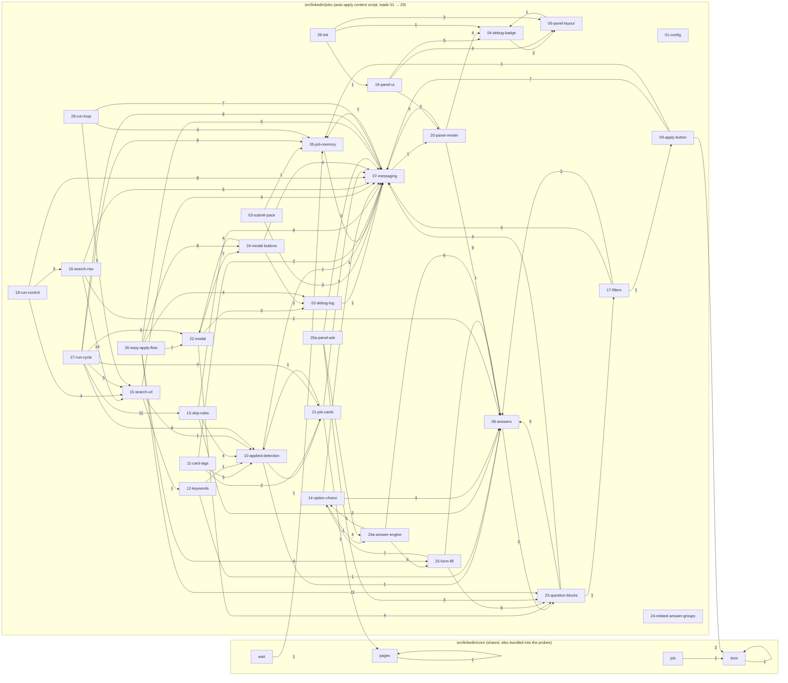

# AutoApply CV extension - code map

_Generated by `tools/codemap.mjs` (`npm run codemap`). Do not edit by hand._

## Folders

| Folder | What lives there |
| --- | --- |
| `src/background` | Service worker: storage, settings, portal API calls, message hub for every content script. |
| `src/linkedin/core` | Shared, class-free LinkedIn detection (cards, job ids, applied state, details pane, apply button, pagination). Also bundled into the console probes. |
| `src/linkedin/jobs` | LinkedIn Jobs auto-apply content script, split into numbered parts that load in order and share one scope. |
| `src/linkedin/outreach` | LinkedIn outreach widgets: WhatsApp leads, email leads, auto-commenter, HR leads (feed/search pages; idle on /jobs). |
| `src/indeed` | Indeed auto-apply content script + panel styles. |
| `src/whatsapp` | WhatsApp Web sender. |
| `src/gmail` | Gmail sender. |
| `src/meet` | Google Meet interview copilot. |
| `src/dashboard` | Bridge between the AutoApply CV web dashboard and the extension. |
| `src/ui` | Toolbar popup and options page. |
| `src/rules` | declarativeNetRequest rules (optional LinkedIn tracker blocking). |
| `src/assets` | Fonts and images. |
| `tools/probes` | Paste-into-console test scripts, built from src/linkedin/core + tools/probes/bodies (`npm run probe` → tools/probes/out). |
| `tools/console` | Standalone console helpers (clear location filter, console-noise debugger). |

## LinkedIn Jobs: who calls whom

Arrows point from the caller to the part that defines the function; the number is how many different functions are called. Only the strongest links are drawn.

## Files and functions

Files are listed in load order. Click a function to jump to it.

### [src/background/background.js](../src/background/background.js) · 3948 lines
Runs on: background service worker

[`normalizePortalOrigin`](../src/background/background.js#L56) · [`persistPortalOriginState`](../src/background/background.js#L66) · [`setPreferredPortalOrigin`](../src/background/background.js#L75) · [`markPortalOriginFailure`](../src/background/background.js#L88) · [`normalizeLastPortalSyncSnapshot`](../src/background/background.js#L102) · [`setLastPortalSyncSnapshot`](../src/background/background.js#L121) · [`fetchRemoteSelectors`](../src/background/background.js#L147) · [`getRemoteSelectors`](../src/background/background.js#L164) · [`notifyDashboardTabs`](../src/background/background.js#L178) · [`sendMessageToTab`](../src/background/background.js#L204) · [`importPortalBatchViaDashboardTab`](../src/background/background.js#L221) · [`finalizePortalImportSuccess`](../src/background/background.js#L256) · [`setPortalQuota`](../src/background/background.js#L333) · [`getPortalQuota`](../src/background/background.js#L346) · [`portalSpendable`](../src/background/background.js#L352) · [`portalAuthHeaders`](../src/background/background.js#L366) · [`openPortalTabOrigins`](../src/background/background.js#L377) · [`portalTargetOrigins`](../src/background/background.js#L398) · [`reasonForStatus`](../src/background/background.js#L412) · [`storeHiresBalance`](../src/background/background.js#L429) · [`chargeOutreachViaPortal`](../src/background/background.js#L446) · [`outreachContactFrom`](../src/background/background.js#L480) · [`reportWhatsAppStatus`](../src/background/background.js#L495) · [`checkOutreachAllowance`](../src/background/background.js#L515) · [`getPortalOrigin`](../src/background/background.js#L544) · [`normalizeLabel`](../src/background/background.js#L554) · [`detectPortalOriginsFromTabs`](../src/background/background.js#L562) · [`detectPortalOriginFromTabs`](../src/background/background.js#L618) · [`refreshPortalScreeningAnswersIntoSettings`](../src/background/background.js#L628) · [`ensurePortalAnswerPoller`](../src/background/background.js#L663) · [`reportPendingQuestionsToPortal`](../src/background/background.js#L673) · [`saveAnswerToPortal`](../src/background/background.js#L735) · [`queueAnswerUpload`](../src/background/background.js#L770) · [`flushAnswerUploads`](../src/background/background.js#L777) · [`getPortalCooldown`](../src/background/background.js#L802) · [`setPortalCooldown`](../src/background/background.js#L812) · [`clearPortalCooldown`](../src/background/background.js#L817) · [`buildPortalImportEntryId`](../src/background/background.js#L821) · [`normalizePortalImportEntry`](../src/background/background.js#L836) · [`dedupePortalImportEntries`](../src/background/background.js#L858) · [`getPortalQueue`](../src/background/background.js#L868) · [`setPortalQueue`](../src/background/background.js#L878) · [`enqueuePortalImport`](../src/background/background.js#L884) · [`flushPortalImportsSoon`](../src/background/background.js#L895) · [`refreshPortalQuota`](../src/background/background.js#L903) · [`flushPortalImports`](../src/background/background.js#L925) · [`emptyRunCounts`](../src/background/background.js#L1045) · [`normalizeCount`](../src/background/background.js#L1055) · [`normalizeRunCounts`](../src/background/background.js#L1059) · [`normalizeRunOutcome`](../src/background/background.js#L1070) · [`normalizeRunSummary`](../src/background/background.js#L1083) · [`sortRunSummaries`](../src/background/background.js#L1098) · [`getRunSummariesState`](../src/background/background.js#L1106) · [`setRunSummariesState`](../src/background/background.js#L1123) · [`findRunSummary`](../src/background/background.js#L1142) · [`upsertRunSummary`](../src/background/background.js#L1148) · [`activateRunSummary`](../src/background/background.js#L1173) · [`finishRunSummary`](../src/background/background.js#L1192) · [`getCurrentRunSummary`](../src/background/background.js#L1211) · [`withDurableRunCounts`](../src/background/background.js#L1218) · [`nowIso`](../src/background/background.js#L1332) · [`currentUtcDateKey`](../src/background/background.js#L1336) · [`nextUtcMidnightIso`](../src/background/background.js#L1344) · [`getDailyCapState`](../src/background/background.js#L1351) · [`setDailyCapUsed`](../src/background/background.js#L1379) · [`sanitizeApiBaseUrl`](../src/background/background.js#L1390) · [`normalizeArray`](../src/background/background.js#L1394) · [`hasWords`](../src/background/background.js#L1406) · [`canonicalScreeningKey`](../src/background/background.js#L1410) · [`questionKeyFromLabel`](../src/background/background.js#L1453) · [`resolveScreeningAnswer`](../src/background/background.js#L1457) · [`getState`](../src/background/background.js#L1477) · [`setState`](../src/background/background.js#L1482) · [`getSettings`](../src/background/background.js#L1487) · [`apiHeaders`](../src/background/background.js#L1541) · [`postToApi`](../src/background/background.js#L1552) · [`pushLog`](../src/background/background.js#L1589) · [`summarizeHistoryForExport`](../src/background/background.js#L1610) · [`exportLogs`](../src/background/background.js#L1707) · [`resetRunState`](../src/background/background.js#L1871) · [`getRunHistory`](../src/background/background.js#L1885) · [`extractLinkedInJobId`](../src/background/background.js#L1895) · [`collectAppliedJobIdsFromEntries`](../src/background/background.js#L1908) · [`getAppliedJobIdsFromHistory`](../src/background/background.js#L1931) · [`getAppliedJobIdsFromPortal`](../src/background/background.js#L1946) · [`getKnownAppliedJobIds`](../src/background/background.js#L1987) · [`buildHistoryEntryId`](../src/background/background.js#L1997) · [`buildRunOutcomeSnapshot`](../src/background/background.js#L2009) · [`appendRunHistory`](../src/background/background.js#L2028) · [`persistProgress`](../src/background/background.js#L2054) · [`saveSettings`](../src/background/background.js#L2107) · [`stripBuiltInOutreachText`](../src/background/background.js#L2227) · [`loadOutreachSettings`](../src/background/background.js#L2235) · [`sanitizeOutreachGroup`](../src/background/background.js#L2245) · [`saveOutreachSettings`](../src/background/background.js#L2267) · [`rememberOutreachOrigin`](../src/background/background.js#L2287) · [`takeOutreachOrigin`](../src/background/background.js#L2298) · [`returnToTab`](../src/background/background.js#L2309) · [`returnFromOutreachTab`](../src/background/background.js#L2321) · [`cleanPhoneNumber`](../src/background/background.js#L2348) · [`saveLeadToStorage`](../src/background/background.js#L2359) · [`handleDispatchWhatsApp`](../src/background/background.js#L2392) · [`handleMessageSent`](../src/background/background.js#L2449) · [`saveEmailLeadToStorage`](../src/background/background.js#L2515) · [`handleDispatchEmail`](../src/background/background.js#L2550) · [`handleEmailMessageSent`](../src/background/background.js#L2624) · [`addAcLog`](../src/background/background.js#L2691) · [`addAcDebugLog`](../src/background/background.js#L2699) · [`getJsoContacts`](../src/background/background.js#L2713) · [`addJsoContact`](../src/background/background.js#L2718) · [`generateMeetCopilotSuggestion`](../src/background/background.js#L3895)

### [src/linkedin/core/dom.js](../src/linkedin/core/dom.js) · 796 lines
Runs on: https://www.linkedin.com/jobs/*, https://*.linkedin.com/jobs/*

LinkedIn Jobs DOM resolver: update-safe detection with fallback chains. LinkedIn renames CSS classes often, so every question ("where are the job tiles?", "what is this tile's job id?", "is it applied?", "where is the detail pane?") is answered by an ordered list of strategies. The first strategy that gives a plausible answer wins, and the result reports which one it was, so breakages are visible instead of silent. Shared by the content script (loaded before linkedin/jobs/*) and the probes in tools/probes/out/. No dependencies; exposes globalThis.CPLinkedInDom.

[`isAppliedLine`](../src/linkedin/core/dom.js#L92) · [`jobIdFromString`](../src/linkedin/core/dom.js#L97) · [`jobIdsIn`](../src/linkedin/core/dom.js#L107) · [`hashText`](../src/linkedin/core/dom.js#L124) · [`jobIdOf`](../src/linkedin/core/dom.js#L186) · [`climbToTile`](../src/linkedin/core/dom.js#L201) · [`cleanTiles`](../src/linkedin/core/dom.js#L217) · [`tilesFromSeeds`](../src/linkedin/core/dom.js#L224) · [`repeatedSiblingGroups`](../src/linkedin/core/dom.js#L238) · [`tilesFromList`](../src/linkedin/core/dom.js#L300) · [`findJobTiles`](../src/linkedin/core/dom.js#L308) · [`appliedMethodOf`](../src/linkedin/core/dom.js#L376) · [`appliedReport`](../src/linkedin/core/dom.js#L391) · [`hasEasyApply`](../src/linkedin/core/dom.js#L403) · [`findApplyButton`](../src/linkedin/core/dom.js#L413) · [`containsList`](../src/linkedin/core/dom.js#L428) · [`paneAround`](../src/linkedin/core/dom.js#L439) · [`jobColumn`](../src/linkedin/core/dom.js#L461) · [`findDetailPane`](../src/linkedin/core/dom.js#L523) · [`findDetailPaneUncached`](../src/linkedin/core/dom.js#L533) · [`detailAppliedMethod`](../src/linkedin/core/dom.js#L548) · [`realClick`](../src/linkedin/core/dom.js#L565) · [`clickTargetsFor`](../src/linkedin/core/dom.js#L582) · [`openTile`](../src/linkedin/core/dom.js#L614) · [`tileLines`](../src/linkedin/core/dom.js#L647) · [`jobHeading`](../src/linkedin/core/dom.js#L659) · [`tileTitle`](../src/linkedin/core/dom.js#L668) · [`titlesMatch`](../src/linkedin/core/dom.js#L672) · [`detailReadiness`](../src/linkedin/core/dom.js#L684) · [`waitForJobReady`](../src/linkedin/core/dom.js#L720) · [`findApplyAction`](../src/linkedin/core/dom.js#L755)

### [src/linkedin/core/wait.js](../src/linkedin/core/wait.js) · 167 lines
Runs on: https://www.linkedin.com/jobs/*, https://*.linkedin.com/jobs/*

Smart waits: wait for what the page is actually doing instead of fixed sleeps. LinkedIn is a single-page app: after a click it changes the URL at once, shows spinners or skeleton cards, then renders the real content in several passes. A fixed sleep is either too short (we read a half-rendered page) or too long (slow runs). These helpers wait until the condition is really true AND the page has stopped changing, with a timeout as a safety net. until(check)          poll a condition until it returns something truthy noLoaders(root)       true when no spinner / skeleton / aria-busy is visible inside root domQuiet(root)        resolves once root has had no DOM changes for quietMs stable(read)          resolves once read() returns the same value for stableMs settled(root, check)  check() true + no loaders + DOM quiet: "fully loaded" Every wait resolves { ok, value, waitedMs, reason } and never throws, so callers can log why a wait gave up. No dependencies. Exposes globalThis.CPLinkedInWait.

[`until`](../src/linkedin/core/wait.js#L38) · [`noLoaders`](../src/linkedin/core/wait.js#L55) · [`domQuiet`](../src/linkedin/core/wait.js#L65) · [`stable`](../src/linkedin/core/wait.js#L91) · [`settled`](../src/linkedin/core/wait.js#L116)

### [src/linkedin/core/pages.js](../src/linkedin/core/pages.js) · 330 lines
Runs on: https://www.linkedin.com/jobs/*, https://*.linkedin.com/jobs/*

LinkedIn Jobs pagination: load all cards on a results page, read the page number, find and use the next-page control. Each question has an ordered list of strategies (class-free ones included), so a LinkedIn markup change degrades to the next strategy instead of stopping the run. Depends on src/linkedin/core/dom.js (CPLinkedInDom) and wait.js (CPLinkedInWait). Shared by the content script and tools/probes/out/1-pages-probe.js, so the probe tests exactly the code the extension runs. Exposes globalThis.CPLinkedInPages.

[`scrollRootOf`](../src/linkedin/core/pages.js#L31) · [`listRoot`](../src/linkedin/core/pages.js#L40) · [`waitForCards`](../src/linkedin/core/pages.js#L50) · [`scrollListToTop`](../src/linkedin/core/pages.js#L67) · [`loadAllCards`](../src/linkedin/core/pages.js#L78) · [`currentPageInfo`](../src/linkedin/core/pages.js#L141) · [`paginationBar`](../src/linkedin/core/pages.js#L168) · [`findNext`](../src/linkedin/core/pages.js#L225) · [`firstCardIds`](../src/linkedin/core/pages.js#L245) · [`goNext`](../src/linkedin/core/pages.js#L257) · [`isNoResultsPage`](../src/linkedin/core/pages.js#L305)

### [src/linkedin/core/job.js](../src/linkedin/core/job.js) · 398 lines
Runs on: https://www.linkedin.com/jobs/*, https://*.linkedin.com/jobs/*

Job facts: title, company, location, workplace type and posted time, read from a job card in the results list and from the opened job's details pane. Class-free with fallbacks: each field tries LinkedIn's known classes first, then structure (job link, company link, <time>), then text lines. Every value comes with the strategy that produced it ("via"), so breakages show up in the probes. Depends on src/linkedin/core/dom.js (CPLinkedInDom) and wait.js (CPLinkedInWait). Shared by the content script and tools/probes/out/2-jobs-probe.js. Exposes globalThis.CPLinkedInJob.

[`pick`](../src/linkedin/core/job.js#L28) · [`cleanTitle`](../src/linkedin/core/job.js#L41) · [`splitDots`](../src/linkedin/core/job.js#L50) · [`contentLines`](../src/linkedin/core/job.js#L55) · [`readCard`](../src/linkedin/core/job.js#L71) · [`readDetails`](../src/linkedin/core/job.js#L120) · [`sectionText`](../src/linkedin/core/job.js#L196) · [`descriptionChars`](../src/linkedin/core/job.js#L211) · [`listActions`](../src/linkedin/core/job.js#L246) · [`sameJobAs`](../src/linkedin/core/job.js#L266) · [`waitForDetails`](../src/linkedin/core/job.js#L282) · [`openAndRead`](../src/linkedin/core/job.js#L323) · [`diagnoseDetails`](../src/linkedin/core/job.js#L366)

### [src/linkedin/jobs/01-config.js](../src/linkedin/jobs/01-config.js) · 112 lines
Runs on: https://www.linkedin.com/jobs/*, https://*.linkedin.com/jobs/*

Constants (timeouts, storage keys, TTLs) and the module-level run state shared by every file below (panel element, run stats, caches).

### [src/linkedin/jobs/02-debug-log.js](../src/linkedin/jobs/02-debug-log.js) · 88 lines
Runs on: https://www.linkedin.com/jobs/*, https://*.linkedin.com/jobs/*

In-memory debug event buffer, timers, page snapshots, and the downloadable debug log export.

[`captureDebugEvent`](../src/linkedin/jobs/02-debug-log.js#L11) · [`startTimer`](../src/linkedin/jobs/02-debug-log.js#L27) · [`endTimer`](../src/linkedin/jobs/02-debug-log.js#L31) · [`capturePageSnapshot`](../src/linkedin/jobs/02-debug-log.js#L39) · [`buildDebugLogExport`](../src/linkedin/jobs/02-debug-log.js#L48) · [`downloadDebugLogFile`](../src/linkedin/jobs/02-debug-log.js#L63)

### [src/linkedin/jobs/03-submit-pace.js](../src/linkedin/jobs/03-submit-pace.js) · 132 lines
Runs on: https://www.linkedin.com/jobs/*, https://*.linkedin.com/jobs/*

Human-like pacing between submissions: persisted pace range, random delay, wait-before-submit with a countdown in the panel.

[`readPersistedNumber`](../src/linkedin/jobs/03-submit-pace.js#L12) · [`writePersistedNumber`](../src/linkedin/jobs/03-submit-pace.js#L22) · [`hydrateSubmitPaceFromStorage`](../src/linkedin/jobs/03-submit-pace.js#L30) · [`clampNumber`](../src/linkedin/jobs/03-submit-pace.js#L38) · [`getSubmitPaceRangeMs`](../src/linkedin/jobs/03-submit-pace.js#L44) · [`formatPaceLabel`](../src/linkedin/jobs/03-submit-pace.js#L50) · [`pickPaceDelayMs`](../src/linkedin/jobs/03-submit-pace.js#L57) · [`setRateLimitUiText`](../src/linkedin/jobs/03-submit-pace.js#L63) · [`enforceSubmitRateLimit`](../src/linkedin/jobs/03-submit-pace.js#L73)

### [src/linkedin/jobs/04-debug-badge.js](../src/linkedin/jobs/04-debug-badge.js) · 131 lines
Runs on: https://www.linkedin.com/jobs/*, https://*.linkedin.com/jobs/*

Current job context, saved panel preferences, and the optional on-page debug badge (?cpDebug=1).

[`wantsDebugUiFromUrl`](../src/linkedin/jobs/04-debug-badge.js#L29) · [`wantsDebugUiFromLocalStorage`](../src/linkedin/jobs/04-debug-badge.js#L38) · [`removeDebugBadge`](../src/linkedin/jobs/04-debug-badge.js#L46) · [`setDebugUiEnabled`](../src/linkedin/jobs/04-debug-badge.js#L56) · [`ensureDebugBadge`](../src/linkedin/jobs/04-debug-badge.js#L62) · [`logPanelDebug`](../src/linkedin/jobs/04-debug-badge.js#L97)

### [src/linkedin/jobs/05-job-memory.js](../src/linkedin/jobs/05-job-memory.js) · 251 lines
Runs on: https://www.linkedin.com/jobs/*, https://*.linkedin.com/jobs/*

Extension-context checks (reload/update detection), sleep, and job memory: jobs seen this run, the per-job outcome cache with TTLs, and the known-applied job id set.

[`isExtensionContextValid`](../src/linkedin/jobs/05-job-memory.js#L14) · [`extensionAssetUrl`](../src/linkedin/jobs/05-job-memory.js#L22) · [`markContextInvalidated`](../src/linkedin/jobs/05-job-memory.js#L26) · [`sleep`](../src/linkedin/jobs/05-job-memory.js#L47) · [`loadRunSeenJobKeys`](../src/linkedin/jobs/05-job-memory.js#L51) · [`persistRunSeenJobKeys`](../src/linkedin/jobs/05-job-memory.js#L67) · [`markJobSeen`](../src/linkedin/jobs/05-job-memory.js#L86) · [`normalizeJobOutcomeCacheEntry`](../src/linkedin/jobs/05-job-memory.js#L93) · [`ensureJobOutcomeCacheSchema`](../src/linkedin/jobs/05-job-memory.js#L106) · [`loadJobOutcomeCache`](../src/linkedin/jobs/05-job-memory.js#L118) · [`persistJobOutcomeCache`](../src/linkedin/jobs/05-job-memory.js#L139) · [`getJobOutcomeTtlMs`](../src/linkedin/jobs/05-job-memory.js#L150) · [`recordJobOutcomeCache`](../src/linkedin/jobs/05-job-memory.js#L159) · [`getCachedJobOutcome`](../src/linkedin/jobs/05-job-memory.js#L175) · [`isTransientSkipCooldownOutcome`](../src/linkedin/jobs/05-job-memory.js#L189) · [`isAppliedCacheHit`](../src/linkedin/jobs/05-job-memory.js#L199) · [`collectKnownAppliedFromLocalOutcomeCache`](../src/linkedin/jobs/05-job-memory.js#L209) · [`refreshKnownAppliedJobIds`](../src/linkedin/jobs/05-job-memory.js#L222) · [`markKnownApplied`](../src/linkedin/jobs/05-job-memory.js#L241) · [`clearSeenJobsForRun`](../src/linkedin/jobs/05-job-memory.js#L247)

### [src/linkedin/jobs/06-panel-layout.js](../src/linkedin/jobs/06-panel-layout.js) · 133 lines
Runs on: https://www.linkedin.com/jobs/*, https://*.linkedin.com/jobs/*

Panel position/size preferences, minimise/maximise, and dragging.

[`loadPanelPrefs`](../src/linkedin/jobs/06-panel-layout.js#L11) · [`savePanelPrefs`](../src/linkedin/jobs/06-panel-layout.js#L28) · [`syncPageAdjustment`](../src/linkedin/jobs/06-panel-layout.js#L36) · [`applyPanelLayout`](../src/linkedin/jobs/06-panel-layout.js#L50) · [`setPanelMinimized`](../src/linkedin/jobs/06-panel-layout.js#L74) · [`setPanelMaximized`](../src/linkedin/jobs/06-panel-layout.js#L80) · [`enablePanelDragging`](../src/linkedin/jobs/06-panel-layout.js#L89)

### [src/linkedin/jobs/07-messaging.js](../src/linkedin/jobs/07-messaging.js) · 182 lines
Runs on: https://www.linkedin.com/jobs/*, https://*.linkedin.com/jobs/*

Messages to the background worker, progress reports, panel log/chat helpers, remote selector overrides, safe querySelector helpers, and page-type checks (search / view / post-apply).

[`sendMessage`](../src/linkedin/jobs/07-messaging.js#L12) · [`reportProgress`](../src/linkedin/jobs/07-messaging.js#L46) · [`escapeHtml`](../src/linkedin/jobs/07-messaging.js#L67) · [`logLine`](../src/linkedin/jobs/07-messaging.js#L74) · [`userChat`](../src/linkedin/jobs/07-messaging.js#L78) · [`botChat`](../src/linkedin/jobs/07-messaging.js#L82) · [`debugLog`](../src/linkedin/jobs/07-messaging.js#L86) · [`getBySelectorList`](../src/linkedin/jobs/07-messaging.js#L91) · [`getAllBySelectorList`](../src/linkedin/jobs/07-messaging.js#L99) · [`loadRemoteSelectors`](../src/linkedin/jobs/07-messaging.js#L107) · [`getS`](../src/linkedin/jobs/07-messaging.js#L117) · [`checkSelectorHealth`](../src/linkedin/jobs/07-messaging.js#L122) · [`safeQuerySelectorAll`](../src/linkedin/jobs/07-messaging.js#L150) · [`isJobsPage`](../src/linkedin/jobs/07-messaging.js#L162) · [`isJobsSearchPage`](../src/linkedin/jobs/07-messaging.js#L166) · [`isJobsViewPage`](../src/linkedin/jobs/07-messaging.js#L170) · [`isPostApplySearchPage`](../src/linkedin/jobs/07-messaging.js#L174) · [`isRunActive`](../src/linkedin/jobs/07-messaging.js#L178)

### [src/linkedin/jobs/08-answers.js](../src/linkedin/jobs/08-answers.js) · 390 lines
Runs on: https://www.linkedin.com/jobs/*, https://*.linkedin.com/jobs/*

Question label normalisation and canonical keys, value formatters (phone, numbers, salary, city, name), and answers to common Easy Apply questions from the profile.

[`normalizeLabel`](../src/linkedin/jobs/08-answers.js#L12) · [`canonicalQuestionKey`](../src/linkedin/jobs/08-answers.js#L19) · [`questionKeyFromLabel`](../src/linkedin/jobs/08-answers.js#L68) · [`cleanQuestionLabel`](../src/linkedin/jobs/08-answers.js#L72) · [`getQuestionLabel`](../src/linkedin/jobs/08-answers.js#L84) · [`normalizePhoneForInput`](../src/linkedin/jobs/08-answers.js#L133) · [`normalizeNumberString`](../src/linkedin/jobs/08-answers.js#L144) · [`normalizeAmount`](../src/linkedin/jobs/08-answers.js#L154) · [`formatNumericAnswer`](../src/linkedin/jobs/08-answers.js#L164) · [`getSalaryAnswer`](../src/linkedin/jobs/08-answers.js#L171) · [`normalizeCityAnswer`](../src/linkedin/jobs/08-answers.js#L181) · [`buildFullName`](../src/linkedin/jobs/08-answers.js#L193) · [`visibleText`](../src/linkedin/jobs/08-answers.js#L203) · [`isMarketingConsentQuestion`](../src/linkedin/jobs/08-answers.js#L207) · [`answerCommonQuestion`](../src/linkedin/jobs/08-answers.js#L216)

### [src/linkedin/jobs/09-apply-button.js](../src/linkedin/jobs/09-apply-button.js) · 310 lines
Runs on: https://www.linkedin.com/jobs/*, https://*.linkedin.com/jobs/*

Clicking (resilientClick), selecting a job card in the list, finding the Apply / Easy Apply button in the details pane (class selectors, then the class-free CPLinkedInDom.findApplyAction), and waiting for it.

[`resilientClick`](../src/linkedin/jobs/09-apply-button.js#L13) · [`selectJobCardInSearchList`](../src/linkedin/jobs/09-apply-button.js#L31) · [`getApplyButtonFromDetailPane`](../src/linkedin/jobs/09-apply-button.js#L93) · [`isDetailPaneStillLoading`](../src/linkedin/jobs/09-apply-button.js#L155) · [`shouldUseConservativeExternalApplyWait`](../src/linkedin/jobs/09-apply-button.js#L182) · [`waitForApplyButtonFromDetailPane`](../src/linkedin/jobs/09-apply-button.js#L187)

### [src/linkedin/jobs/10-applied-detection.js](../src/linkedin/jobs/10-applied-detection.js) · 296 lines
Runs on: https://www.linkedin.com/jobs/*, https://*.linkedin.com/jobs/*

Is a job already applied? Card and details-pane detection (5 strategies + CPLinkedInDom fallback). LinkedIn job id / URL helpers, job key of a card, card metadata (title, company, location).

[`isAppliedStatusText`](../src/linkedin/jobs/10-applied-detection.js#L13) · [`isAppliedStatusLine`](../src/linkedin/jobs/10-applied-detection.js#L28) · [`detectAppliedCardMethod`](../src/linkedin/jobs/10-applied-detection.js#L37) · [`isAlreadyAppliedCard`](../src/linkedin/jobs/10-applied-detection.js#L74) · [`detectAppliedInDetailPane`](../src/linkedin/jobs/10-applied-detection.js#L89) · [`extractLinkedInJobIdFromUrl`](../src/linkedin/jobs/10-applied-detection.js#L115) · [`extractLinkedInViewJobIdFromUrl`](../src/linkedin/jobs/10-applied-detection.js#L127) · [`buildCanonicalLinkedInJobUrl`](../src/linkedin/jobs/10-applied-detection.js#L134) · [`extractLinkedInJobIdFromEntityUrn`](../src/linkedin/jobs/10-applied-detection.js#L146) · [`getJobKeyFromCard`](../src/linkedin/jobs/10-applied-detection.js#L157) · [`parseListSetting`](../src/linkedin/jobs/10-applied-detection.js#L198) · [`cleanJobTitle`](../src/linkedin/jobs/10-applied-detection.js#L208) · [`extractCardMeta`](../src/linkedin/jobs/10-applied-detection.js#L247) · [`getCardElementContainer`](../src/linkedin/jobs/10-applied-detection.js#L289)

### [src/linkedin/jobs/11-card-tags.js](../src/linkedin/jobs/11-card-tags.js) · 217 lines
Runs on: https://www.linkedin.com/jobs/*, https://*.linkedin.com/jobs/*

Highlights the active card and draws APPLIED / ALREADY APPLIED / SKIPPED tags on cards; a light MutationObserver repaints tags when LinkedIn re-renders the list.

[`clearActiveJobCardHighlights`](../src/linkedin/jobs/11-card-tags.js#L12) · [`highlightActiveJobCard`](../src/linkedin/jobs/11-card-tags.js#L25) · [`formatFriendlySkipReason`](../src/linkedin/jobs/11-card-tags.js#L51) · [`markJobCardStatus`](../src/linkedin/jobs/11-card-tags.js#L67) · [`paintJobCardStatuses`](../src/linkedin/jobs/11-card-tags.js#L124) · [`isForeignAddition`](../src/linkedin/jobs/11-card-tags.js#L152) · [`schedulePaint`](../src/linkedin/jobs/11-card-tags.js#L161) · [`startCardPaintObserver`](../src/linkedin/jobs/11-card-tags.js#L183) · [`highlightDetailPane`](../src/linkedin/jobs/11-card-tags.js#L197)

### [src/linkedin/jobs/12-keywords.js](../src/linkedin/jobs/12-keywords.js) · 506 lines
Runs on: https://www.linkedin.com/jobs/*, https://*.linkedin.com/jobs/*

Role keyword synonym dictionary and title/keyword matching against the configured search terms.

[`getAlternativeKeywordsForTerm`](../src/linkedin/jobs/12-keywords.js#L420) · [`isKnownDictionaryRole`](../src/linkedin/jobs/12-keywords.js#L432) · [`isJobMatchingSearchKeywords`](../src/linkedin/jobs/12-keywords.js#L461)

### [src/linkedin/jobs/13-skip-rules.js](../src/linkedin/jobs/13-skip-rules.js) · 361 lines
Runs on: https://www.linkedin.com/jobs/*, https://*.linkedin.com/jobs/*

Skip rules: title/company/experience rules, job description and About-the-company checks, details-pane refresh checks, and LinkedIn's daily Easy Apply limit detection + pause.

[`shouldSkipByRules`](../src/linkedin/jobs/13-skip-rules.js#L12) · [`extractYearsOfExperience`](../src/linkedin/jobs/13-skip-rules.js#L36) · [`getJobDescriptionText`](../src/linkedin/jobs/13-skip-rules.js#L46) · [`getGenericDetails`](../src/linkedin/jobs/13-skip-rules.js#L62) · [`getDetailPaneTitleText`](../src/linkedin/jobs/13-skip-rules.js#L73) · [`getDetailPaneCompanyText`](../src/linkedin/jobs/13-skip-rules.js#L84) · [`getDetailPaneSnapshot`](../src/linkedin/jobs/13-skip-rules.js#L94) · [`textLooselyMatches`](../src/linkedin/jobs/13-skip-rules.js#L105) · [`didDetailPaneRefreshForCard`](../src/linkedin/jobs/13-skip-rules.js#L113) · [`waitForCardDetails`](../src/linkedin/jobs/13-skip-rules.js#L141) · [`waitForDetailPaneRefresh`](../src/linkedin/jobs/13-skip-rules.js#L161) · [`shouldSkipByDescription`](../src/linkedin/jobs/13-skip-rules.js#L176) · [`getAboutCompanyText`](../src/linkedin/jobs/13-skip-rules.js#L220) · [`shouldSkipByAboutCompany`](../src/linkedin/jobs/13-skip-rules.js#L230) · [`hasDailyEasyApplyLimitSignal`](../src/linkedin/jobs/13-skip-rules.js#L254) · [`pauseRunForDailyEasyApplyLimit`](../src/linkedin/jobs/13-skip-rules.js#L328) · [`pauseRunOutOfHires`](../src/linkedin/jobs/13-skip-rules.js#L351)

### [src/linkedin/jobs/14-option-choice.js](../src/linkedin/jobs/14-option-choice.js) · 373 lines
Runs on: https://www.linkedin.com/jobs/*, https://*.linkedin.com/jobs/*

Outcome recording, AI answer requests, choosing the best option for selects/radios, and picking the preferred resume.

[`recordOutcome`](../src/linkedin/jobs/14-option-choice.js#L12) · [`requestAiAnswer`](../src/linkedin/jobs/14-option-choice.js#L23) · [`requestAiAnswerCandidates`](../src/linkedin/jobs/14-option-choice.js#L54) · [`buildAnswerPhrases`](../src/linkedin/jobs/14-option-choice.js#L71) · [`optionFingerprint`](../src/linkedin/jobs/14-option-choice.js#L87) · [`isConsentLikeQuestion`](../src/linkedin/jobs/14-option-choice.js#L91) · [`selectBestOption`](../src/linkedin/jobs/14-option-choice.js#L108) · [`selectFallbackOption`](../src/linkedin/jobs/14-option-choice.js#L125) · [`getRadioOptionText`](../src/linkedin/jobs/14-option-choice.js#L179) · [`getRadioClickTarget`](../src/linkedin/jobs/14-option-choice.js#L204) · [`isResumeOptionText`](../src/linkedin/jobs/14-option-choice.js#L215) · [`getResumeOptionIdentity`](../src/linkedin/jobs/14-option-choice.js#L223) · [`getResumeChoiceCacheKey`](../src/linkedin/jobs/14-option-choice.js#L236) · [`getResumeOptionRecencyScore`](../src/linkedin/jobs/14-option-choice.js#L244) · [`getPreferredResumeOption`](../src/linkedin/jobs/14-option-choice.js#L316) · [`logOutcome`](../src/linkedin/jobs/14-option-choice.js#L369)

### [src/linkedin/jobs/15-search-url.js](../src/linkedin/jobs/15-search-url.js) · 521 lines
Runs on: https://www.linkedin.com/jobs/*, https://*.linkedin.com/jobs/*

Search terms and location decisions, building/normalising LinkedIn search URLs (keywords, date posted, sort, work mode), stored last-search URL, and the redirect-loop guard.

[`getConfiguredSearchTerms`](../src/linkedin/jobs/15-search-url.js#L12) · [`getSwitchNumber`](../src/linkedin/jobs/15-search-url.js#L23) · [`getCurrentSearchKeyword`](../src/linkedin/jobs/15-search-url.js#L27) · [`isRemoteLikeSearchValue`](../src/linkedin/jobs/15-search-url.js#L38) · [`isRemoteModeSelected`](../src/linkedin/jobs/15-search-url.js#L49) · [`clearSearchLocationQueryParams`](../src/linkedin/jobs/15-search-url.js#L53) · [`resetRemoteLocationKeywordCursor`](../src/linkedin/jobs/15-search-url.js#L59) · [`getRemoteLocationKeywordPool`](../src/linkedin/jobs/15-search-url.js#L63) · [`shouldUseRemoteLocationKeywords`](../src/linkedin/jobs/15-search-url.js#L82) · [`getEffectiveSearchLocation`](../src/linkedin/jobs/15-search-url.js#L90) · [`buildSearchLocationDecisionMeta`](../src/linkedin/jobs/15-search-url.js#L115) · [`shouldClearStaleLocationQueryParams`](../src/linkedin/jobs/15-search-url.js#L140) · [`buildJobsSearchUrl`](../src/linkedin/jobs/15-search-url.js#L162) · [`getActiveRunSearchUrl`](../src/linkedin/jobs/15-search-url.js#L171) · [`searchRadiusToLinkedInParam`](../src/linkedin/jobs/15-search-url.js#L186) · [`datePostedToLinkedInParam`](../src/linkedin/jobs/15-search-url.js#L191) · [`workModeValueToLinkedInCode`](../src/linkedin/jobs/15-search-url.js#L199) · [`onSiteToLinkedInParam`](../src/linkedin/jobs/15-search-url.js#L207) · [`getBroaderDatePostedValue`](../src/linkedin/jobs/15-search-url.js#L214) · [`getNextDatePostedValue`](../src/linkedin/jobs/15-search-url.js#L222) · [`sortByToLinkedInParam`](../src/linkedin/jobs/15-search-url.js#L236) · [`getAlternateSortValue`](../src/linkedin/jobs/15-search-url.js#L243) · [`clearTransientSearchQueryParams`](../src/linkedin/jobs/15-search-url.js#L249) · [`hasTransientSearchQueryParams`](../src/linkedin/jobs/15-search-url.js#L255) · [`hasSearchLocationQueryParams`](../src/linkedin/jobs/15-search-url.js#L264) · [`readStoredSearchResultsUrl`](../src/linkedin/jobs/15-search-url.js#L273) · [`writeStoredSearchResultsUrl`](../src/linkedin/jobs/15-search-url.js#L286) · [`buildCanonicalSearchUrl`](../src/linkedin/jobs/15-search-url.js#L297) · [`normalizeSearchUrlWithoutReload`](../src/linkedin/jobs/15-search-url.js#L368) · [`getResumableSearchUrl`](../src/linkedin/jobs/15-search-url.js#L382) · [`isSameSearchUrl`](../src/linkedin/jobs/15-search-url.js#L405) · [`readSearchRedirectGuard`](../src/linkedin/jobs/15-search-url.js#L427) · [`noteSearchRedirect`](../src/linkedin/jobs/15-search-url.js#L436) · [`wasRecentlyRedirectedTo`](../src/linkedin/jobs/15-search-url.js#L445) · [`diffSearchUrlKeys`](../src/linkedin/jobs/15-search-url.js#L451) · [`ensureSearchQueryParams`](../src/linkedin/jobs/15-search-url.js#L464) · [`relaxDatePostedForEmptyResults`](../src/linkedin/jobs/15-search-url.js#L503)

### [src/linkedin/jobs/16-search-nav.js](../src/linkedin/jobs/16-search-nav.js) · 265 lines
Runs on: https://www.linkedin.com/jobs/*, https://*.linkedin.com/jobs/*

Search term rotation, next results page (CPLinkedInPages: load all cards, page number, next control, URL fallback), and the LinkedIn location input.

[`ensureSearchTermIfNeeded`](../src/linkedin/jobs/16-search-nav.js#L12) · [`rotateSearchTerm`](../src/linkedin/jobs/16-search-nav.js#L53) · [`buildNextPageUrlByStart`](../src/linkedin/jobs/16-search-nav.js#L69) · [`gotoNextResultsPage`](../src/linkedin/jobs/16-search-nav.js#L88) · [`setSearchLocationIfNeeded`](../src/linkedin/jobs/16-search-nav.js#L133) · [`getJobsSearchLocationInput`](../src/linkedin/jobs/16-search-nav.js#L175) · [`clearLinkedInSearchLocationInput`](../src/linkedin/jobs/16-search-nav.js#L197) · [`rotateRemoteLocationKeyword`](../src/linkedin/jobs/16-search-nav.js#L252)

### [src/linkedin/jobs/17-filters.js](../src/linkedin/jobs/17-filters.js) · 383 lines
Runs on: https://www.linkedin.com/jobs/*, https://*.linkedin.com/jobs/*

Easy Apply filter and the 'All filters' modal: switches, options, autocomplete values (companies, locations).

[`urlHasEasyApplyFilter`](../src/linkedin/jobs/17-filters.js#L12) · [`findEasyApplyFilterPill`](../src/linkedin/jobs/17-filters.js#L24) · [`isEasyApplyPillActive`](../src/linkedin/jobs/17-filters.js#L44) · [`applyEasyApplyFilterIfNeeded`](../src/linkedin/jobs/17-filters.js#L63) · [`hasAdvancedFiltersConfigured`](../src/linkedin/jobs/17-filters.js#L137) · [`getAdvancedFilterSignature`](../src/linkedin/jobs/17-filters.js#L155) · [`hasAppliedAdvancedFiltersForCurrentRun`](../src/linkedin/jobs/17-filters.js#L173) · [`markAdvancedFiltersAppliedForCurrentRun`](../src/linkedin/jobs/17-filters.js#L189) · [`optionTextMatches`](../src/linkedin/jobs/17-filters.js#L203) · [`isVisibleElement`](../src/linkedin/jobs/17-filters.js#L214) · [`findVisibleControlByText`](../src/linkedin/jobs/17-filters.js#L222) · [`findFiltersModal`](../src/linkedin/jobs/17-filters.js#L237) · [`waitForFiltersModalOpen`](../src/linkedin/jobs/17-filters.js#L245) · [`findFilterApplyButton`](../src/linkedin/jobs/17-filters.js#L255) · [`setSwitchFilterByLabel`](../src/linkedin/jobs/17-filters.js#L263) · [`findAutocompleteInputByHint`](../src/linkedin/jobs/17-filters.js#L283) · [`addAutocompleteFilterValues`](../src/linkedin/jobs/17-filters.js#L294) · [`applyAdvancedFiltersIfNeeded`](../src/linkedin/jobs/17-filters.js#L314)

### [src/linkedin/jobs/18-run-control.js](../src/linkedin/jobs/18-run-control.js) · 309 lines
Runs on: https://www.linkedin.com/jobs/*, https://*.linkedin.com/jobs/*

Preparing a run, live auto-submit toggle, and the panel chat commands (start, pause, set city, clear locations, ...).

[`prepareRun`](../src/linkedin/jobs/18-run-control.js#L12) · [`setLiveAutoSubmitEnabled`](../src/linkedin/jobs/18-run-control.js#L60) · [`handleChatCommand`](../src/linkedin/jobs/18-run-control.js#L93) · [`reportStartFailure`](../src/linkedin/jobs/18-run-control.js#L301)

### [src/linkedin/jobs/19-panel-ui.js](../src/linkedin/jobs/19-panel-ui.js) · 249 lines
Runs on: https://www.linkedin.com/jobs/*, https://*.linkedin.com/jobs/*

Builds the copilot panel (tabs, buttons, chat box) and wires its events.

[`ensurePanelConnected`](../src/linkedin/jobs/19-panel-ui.js#L11) · [`promoteToTopLayer`](../src/linkedin/jobs/19-panel-ui.js#L27) · [`promotePanelElementsToTopLayer`](../src/linkedin/jobs/19-panel-ui.js#L38) · [`findOpenModalDialog`](../src/linkedin/jobs/19-panel-ui.js#L43) · [`startTopLayerWatch`](../src/linkedin/jobs/19-panel-ui.js#L52) · [`ensurePanel`](../src/linkedin/jobs/19-panel-ui.js#L61)

### [src/linkedin/jobs/20-panel-render.js](../src/linkedin/jobs/20-panel-render.js) · 425 lines
Runs on: https://www.linkedin.com/jobs/*, https://*.linkedin.com/jobs/*

Panel log feed: AI cards, decision chains, 'now' card, and renderState() which paints run status, counters and logs.

[`trimLogPrefix`](../src/linkedin/jobs/20-panel-render.js#L12) · [`isUserFacingAiLog`](../src/linkedin/jobs/20-panel-render.js#L21) · [`formatAiFeedCard`](../src/linkedin/jobs/20-panel-render.js#L35) · [`pickAiTitle`](../src/linkedin/jobs/20-panel-render.js#L111) · [`deriveNowCard`](../src/linkedin/jobs/20-panel-render.js#L116) · [`skipReasonParts`](../src/linkedin/jobs/20-panel-render.js#L193) · [`formatJobHistoryCard`](../src/linkedin/jobs/20-panel-render.js#L203) · [`historyForPanel`](../src/linkedin/jobs/20-panel-render.js#L224) · [`refreshPanelHistory`](../src/linkedin/jobs/20-panel-render.js#L233) · [`nowBannerHtml`](../src/linkedin/jobs/20-panel-render.js#L247) · [`emptyListHtml`](../src/linkedin/jobs/20-panel-render.js#L251) · [`buildLogRenderSignature`](../src/linkedin/jobs/20-panel-render.js#L255) · [`describeHiresState`](../src/linkedin/jobs/20-panel-render.js#L277) · [`renderState`](../src/linkedin/jobs/20-panel-render.js#L295) · [`getBootstrap`](../src/linkedin/jobs/20-panel-render.js#L417)

### [src/linkedin/jobs/21-job-cards.js](../src/linkedin/jobs/21-job-cards.js) · 213 lines
Runs on: https://www.linkedin.com/jobs/*, https://*.linkedin.com/jobs/*

Job cards on the results page: collectJobCards (CPLinkedInDom chain + legacy fallback), Easy Apply signal, waiting for cards, list scroll container, loading all cards, dismissing a card.

[`cardRootFromJobAnchor`](../src/linkedin/jobs/21-job-cards.js#L24) · [`collectJobCards`](../src/linkedin/jobs/21-job-cards.js#L47) · [`hasEasyApplySignalOnCard`](../src/linkedin/jobs/21-job-cards.js#L89) · [`getCardAnchor`](../src/linkedin/jobs/21-job-cards.js#L119) · [`waitForJobsToRender`](../src/linkedin/jobs/21-job-cards.js#L132) · [`getJobListScrollContainer`](../src/linkedin/jobs/21-job-cards.js#L143) · [`loadAllJobCardsOnPage`](../src/linkedin/jobs/21-job-cards.js#L167) · [`dismissJobCard`](../src/linkedin/jobs/21-job-cards.js#L189)

### [src/linkedin/jobs/22-modal.js](../src/linkedin/jobs/22-modal.js) · 191 lines
Runs on: https://www.linkedin.com/jobs/*, https://*.linkedin.com/jobs/*

The Easy Apply dialog: finding it, post-apply 'Application sent' screen, waiting for open/ready/step-settled, loading state.

[`getActiveModal`](../src/linkedin/jobs/22-modal.js#L32) · [`isPostApplyDialog`](../src/linkedin/jobs/22-modal.js#L42) · [`findPostApplyDialog`](../src/linkedin/jobs/22-modal.js#L50) · [`waitUntil`](../src/linkedin/jobs/22-modal.js#L55) · [`describeModalState`](../src/linkedin/jobs/22-modal.js#L66) · [`summarizeModalState`](../src/linkedin/jobs/22-modal.js#L82) · [`finishPostApplyDialog`](../src/linkedin/jobs/22-modal.js#L98) · [`clearLeftoverDialogs`](../src/linkedin/jobs/22-modal.js#L118) · [`waitForModalStepSettled`](../src/linkedin/jobs/22-modal.js#L132) · [`isModalLoading`](../src/linkedin/jobs/22-modal.js#L155) · [`waitForModalOpen`](../src/linkedin/jobs/22-modal.js#L163) · [`waitForModalReady`](../src/linkedin/jobs/22-modal.js#L173)

### [src/linkedin/jobs/23-question-blocks.js](../src/linkedin/jobs/23-question-blocks.js) · 656 lines
Runs on: https://www.linkedin.com/jobs/*, https://*.linkedin.com/jobs/*

Form question blocks: collecting them, required/invalid state, validation messages (class-based + aria fallback), pending questions and manual answers.

[`countQuestionsIn`](../src/linkedin/jobs/23-question-blocks.js#L16) · [`singleQuestionBlock`](../src/linkedin/jobs/23-question-blocks.js#L36) · [`collectQuestionBlocks`](../src/linkedin/jobs/23-question-blocks.js#L48) · [`truncateDebugText`](../src/linkedin/jobs/23-question-blocks.js#L106) · [`isRequiredQuestionBlock`](../src/linkedin/jobs/23-question-blocks.js#L112) · [`collapseValidationText`](../src/linkedin/jobs/23-question-blocks.js#L121) · [`getValidationMessageFromElements`](../src/linkedin/jobs/23-question-blocks.js#L125) · [`getQuestionBlockValidationMessage`](../src/linkedin/jobs/23-question-blocks.js#L135) · [`isQuestionBlockInvalid`](../src/linkedin/jobs/23-question-blocks.js#L175) · [`describeQuestionField`](../src/linkedin/jobs/23-question-blocks.js#L186) · [`getQuestionBlockState`](../src/linkedin/jobs/23-question-blocks.js#L243) · [`getQuestionBlockStateBase`](../src/linkedin/jobs/23-question-blocks.js#L248) · [`summarizeQuestionBlockState`](../src/linkedin/jobs/23-question-blocks.js#L423) · [`collectQuestionBlockDiagnostics`](../src/linkedin/jobs/23-question-blocks.js#L436) · [`isBlankValue`](../src/linkedin/jobs/23-question-blocks.js#L441) · [`isPlaceholderOption`](../src/linkedin/jobs/23-question-blocks.js#L445) · [`doesQuestionStateNeedAttention`](../src/linkedin/jobs/23-question-blocks.js#L450) · [`collectActionableQuestions`](../src/linkedin/jobs/23-question-blocks.js#L456) · [`buildPendingQuestionsFromValidation`](../src/linkedin/jobs/23-question-blocks.js#L480) · [`buildPendingQuestionsFromDiagnostics`](../src/linkedin/jobs/23-question-blocks.js#L506) · [`resolveManualAnswer`](../src/linkedin/jobs/23-question-blocks.js#L534) · [`waitForPendingAnswersFromSettings`](../src/linkedin/jobs/23-question-blocks.js#L550) · [`getModalValidationMessage`](../src/linkedin/jobs/23-question-blocks.js#L576) · [`getModalValidationMessageRaw`](../src/linkedin/jobs/23-question-blocks.js#L580) · [`getAriaValidationMessage`](../src/linkedin/jobs/23-question-blocks.js#L586) · [`getKnownValidationMessage`](../src/linkedin/jobs/23-question-blocks.js#L599) · [`getModalSignature`](../src/linkedin/jobs/23-question-blocks.js#L614) · [`describeStepBlockers`](../src/linkedin/jobs/23-question-blocks.js#L633)

### [src/linkedin/jobs/24-modal-buttons.js](../src/linkedin/jobs/24-modal-buttons.js) · 248 lines
Runs on: https://www.linkedin.com/jobs/*, https://*.linkedin.com/jobs/*

Date picker, modal controls (Next / Review / Submit / Done, native buttons first then role=button), Save-application prompt, closing the dialog, submit completion, follow-company checkbox.

[`isPlaceholderOptionText`](../src/linkedin/jobs/24-modal-buttons.js#L13) · [`selectTodayDateIfPresent`](../src/linkedin/jobs/24-modal-buttons.js#L18) · [`isControlDisabled`](../src/linkedin/jobs/24-modal-buttons.js#L52) · [`getModalControls`](../src/linkedin/jobs/24-modal-buttons.js#L58) · [`findSubmitButton`](../src/linkedin/jobs/24-modal-buttons.js#L66) · [`findDoneOrCloseButton`](../src/linkedin/jobs/24-modal-buttons.js#L76) · [`getVisibleModalButtons`](../src/linkedin/jobs/24-modal-buttons.js#L87) · [`findModalButtonByIncludes`](../src/linkedin/jobs/24-modal-buttons.js#L91) · [`findSaveApplicationPromptModal`](../src/linkedin/jobs/24-modal-buttons.js#L100) · [`isSaveApplicationPrompt`](../src/linkedin/jobs/24-modal-buttons.js#L110) · [`dismissSaveApplicationPrompt`](../src/linkedin/jobs/24-modal-buttons.js#L124) · [`closePostSubmitUi`](../src/linkedin/jobs/24-modal-buttons.js#L153) · [`findNextOrReviewButton`](../src/linkedin/jobs/24-modal-buttons.js#L190) · [`didSubmitComplete`](../src/linkedin/jobs/24-modal-buttons.js#L208) · [`applyFollowCompanyPreference`](../src/linkedin/jobs/24-modal-buttons.js#L226)

### [src/linkedin/jobs/24-related-answer-groups.js](../src/linkedin/jobs/24-related-answer-groups.js) · 93 lines
Runs on: https://www.linkedin.com/jobs/*, https://*.linkedin.com/jobs/*

Related-question groups: LinkedIn words the same question many ways ("What is your current CTC?", "Current salary in LPA", "Please update your current ctc"). When a question has no answer of its own, the answer engine (24a-answer-engine.js) can borrow the user's saved answer to a related question. The group rules mirror src/lib/screening-groups.ts on the site (admin "Related groups" view). Only groups whose answer is interchangeable are listed in RELATED_USABLE_GROUPS; groups such as "experience with one technology" or "preferred salary range" would give a wrong answer.

[`relatedNormalizeText`](../src/linkedin/jobs/24-related-answer-groups.js#L45) · [`relatedGroupOf`](../src/linkedin/jobs/24-related-answer-groups.js#L49) · [`relatedUnitHint`](../src/linkedin/jobs/24-related-answer-groups.js#L58) · [`relatedGroupAnswers`](../src/linkedin/jobs/24-related-answer-groups.js#L71)

### [src/linkedin/jobs/24a-answer-engine.js](../src/linkedin/jobs/24a-answer-engine.js) · 618 lines
Runs on: https://www.linkedin.com/jobs/*, https://*.linkedin.com/jobs/*

One ordered pipeline for every Easy Apply question: 1. type     detectQuestionType: number / email / tel / url / text / textarea / select / radio / checkbox / combobox / date, plus the options a choice question offers 2. stored   the local answer bank (chrome.storage.local "cpAnswerBank": answers that passed before, AI answers, dashboard answers) and settings.screeningAnswers; exact question key first, then a close label match (same type only) 3. profile  rules over the saved profile (answerCommonQuestion + structured fallbacks) 4. AI       Groq through the portal (/api/ai/answer), asked for alternatives too 5. you      the dashboard "Action needed" question (existing tier in 26-easy-apply-flow.js) Every candidate is converted to the question's type before use (a number question gets "3", a select gets one of its own options, an email must look like an email); a candidate that cannot fit is dropped instead of typed in. When LinkedIn rejects an answer, retryRejectedAnswers fills the next-ranked candidate not tried yet for that field. Answers that pass a step are counted as good, rejected ones are ranked down.

[`loadAnswerBank`](../src/linkedin/jobs/24a-answer-engine.js#L33) · [`scheduleAnswerBankSave`](../src/linkedin/jobs/24a-answer-engine.js#L47) · [`answerBankKey`](../src/linkedin/jobs/24a-answer-engine.js#L60) · [`rememberAnswer`](../src/linkedin/jobs/24a-answer-engine.js#L71) · [`detectQuestionType`](../src/linkedin/jobs/24a-answer-engine.js#L108) · [`skillOf`](../src/linkedin/jobs/24a-answer-engine.js#L190) · [`questionConcept`](../src/linkedin/jobs/24a-answer-engine.js#L201) · [`trigramSimilarity`](../src/linkedin/jobs/24a-answer-engine.js#L216) · [`similarBankEntries`](../src/linkedin/jobs/24a-answer-engine.js#L253) · [`coerceAnswer`](../src/linkedin/jobs/24a-answer-engine.js#L276) · [`gatherAnswerCandidates`](../src/linkedin/jobs/24a-answer-engine.js#L312) · [`setNativeValue`](../src/linkedin/jobs/24a-answer-engine.js#L384) · [`currentAnswerOf`](../src/linkedin/jobs/24a-answer-engine.js#L393) · [`applyEngineAnswer`](../src/linkedin/jobs/24a-answer-engine.js#L405) · [`readTriedAnswers`](../src/linkedin/jobs/24a-answer-engine.js#L441) · [`markEngineAnswer`](../src/linkedin/jobs/24a-answer-engine.js#L449) · [`fillFromAnswerEngine`](../src/linkedin/jobs/24a-answer-engine.js#L460) · [`answerFormatVariants`](../src/linkedin/jobs/24a-answer-engine.js#L483) · [`retryRejectedAnswers`](../src/linkedin/jobs/24a-answer-engine.js#L523) · [`snapshotStepAnswers`](../src/linkedin/jobs/24a-answer-engine.js#L593) · [`rememberAcceptedAnswers`](../src/linkedin/jobs/24a-answer-engine.js#L615)

### [src/linkedin/jobs/25-form-fill.js](../src/linkedin/jobs/25-form-fill.js) · 772 lines
Runs on: https://www.linkedin.com/jobs/*, https://*.linkedin.com/jobs/*

Filling the form: consent checkboxes, years/number/text fallbacks, select and combobox answers, unlabeled blocks, fillQuestionBlock, validation auto-fix.

[`isFollowCompanyCheckbox`](../src/linkedin/jobs/25-form-fill.js#L12) · [`getCheckboxLabel`](../src/linkedin/jobs/25-form-fill.js#L23) · [`applySubmitConsentCheckboxes`](../src/linkedin/jobs/25-form-fill.js#L35) · [`isCustomEntitySelectionBlock`](../src/linkedin/jobs/25-form-fill.js#L68) · [`getYearsFallback`](../src/linkedin/jobs/25-form-fill.js#L82) · [`isYearsExperienceQuestion`](../src/linkedin/jobs/25-form-fill.js#L90) · [`getStructuredTextFallback`](../src/linkedin/jobs/25-form-fill.js#L95) · [`shouldUseNumericFallbackForTextInput`](../src/linkedin/jobs/25-form-fill.js#L155) · [`getSelectRuleAnswer`](../src/linkedin/jobs/25-form-fill.js#L172) · [`applyComboboxOption`](../src/linkedin/jobs/25-form-fill.js#L212) · [`fillUnlabeledQuestionBlock`](../src/linkedin/jobs/25-form-fill.js#L347) · [`fillQuestionBlock`](../src/linkedin/jobs/25-form-fill.js#L446) · [`collectValidationSignals`](../src/linkedin/jobs/25-form-fill.js#L684) · [`attemptValidationAutoFix`](../src/linkedin/jobs/25-form-fill.js#L693) · [`forceAnswerModalQuestions`](../src/linkedin/jobs/25-form-fill.js#L759)

### [src/linkedin/jobs/25a-panel-ask.js](../src/linkedin/jobs/25a-panel-ask.js) · 317 lines
Runs on: https://www.linkedin.com/jobs/*, https://*.linkedin.com/jobs/*

Asks the user an unanswered question right in the AutoApply panel, instead of sending them to the dashboard. The answer is put into the real LinkedIn field and checked live: our own type check first (a number field needs a number, a dropdown needs one of its options), then LinkedIn's validation message. If either says no, the card stays open with the reason so the user can fix it and try again. Used by processEasyApplyModal in 26-easy-apply-flow.js.

[`cancelPanelAsk`](../src/linkedin/jobs/25a-panel-ask.js#L30) · [`askAnswerTypeFor`](../src/linkedin/jobs/25a-panel-ask.js#L34) · [`askTypeMismatchMessage`](../src/linkedin/jobs/25a-panel-ask.js#L41) · [`askFireInput`](../src/linkedin/jobs/25a-panel-ask.js#L53) · [`collectTypeaheadOptions`](../src/linkedin/jobs/25a-panel-ask.js#L58) · [`applyTypeaheadAnswer`](../src/linkedin/jobs/25a-panel-ask.js#L72) · [`tryAnswerInForm`](../src/linkedin/jobs/25a-panel-ask.js#L115) · [`ensurePanelAskElement`](../src/linkedin/jobs/25a-panel-ask.js#L150) · [`askInputHtml`](../src/linkedin/jobs/25a-panel-ask.js#L168) · [`askQuestionsInPanel`](../src/linkedin/jobs/25a-panel-ask.js#L190)

### [src/linkedin/jobs/26-easy-apply-flow.js](../src/linkedin/jobs/26-easy-apply-flow.js) · 526 lines
Runs on: https://www.linkedin.com/jobs/*, https://*.linkedin.com/jobs/*

processEasyApplyModal: walks the Easy Apply steps (fill, Next/Review, Submit, stop on unknown questions).

[`processEasyApplyModal`](../src/linkedin/jobs/26-easy-apply-flow.js#L12)

### [src/linkedin/jobs/27-run-cycle.js](../src/linkedin/jobs/27-run-cycle.js) · 862 lines
Runs on: https://www.linkedin.com/jobs/*, https://*.linkedin.com/jobs/*

runCycle: one pass over the current results page (pick next card, open it, checks, apply or skip, record outcome).

[`runCycle`](../src/linkedin/jobs/27-run-cycle.js#L12)

### [src/linkedin/jobs/28-run-loop.js](../src/linkedin/jobs/28-run-loop.js) · 256 lines
Runs on: https://www.linkedin.com/jobs/*, https://*.linkedin.com/jobs/*

runAutomationLoop (cycles, page/term rotation, no-progress guard) and state polling from the background worker.

[`runAutomationLoop`](../src/linkedin/jobs/28-run-loop.js#L12) · [`startStatePolling`](../src/linkedin/jobs/28-run-loop.js#L228)

### [src/linkedin/jobs/29-init.js](../src/linkedin/jobs/29-init.js) · 49 lines
Runs on: https://www.linkedin.com/jobs/*, https://*.linkedin.com/jobs/*

Entry point: runs once per tab. Creates the panel, hotkey (Alt+Shift+C), remote selectors, card-tag observer, and state polling.

### [src/linkedin/outreach/outreach_ui.js](../src/linkedin/outreach/outreach_ui.js) · 363 lines
Runs on: https://www.linkedin.com/*, https://*.linkedin.com/*

Shared UI helpers for the three outreach widgets (WhatsApp, Email, LinkedIn comments). They build the same panel as the Auto Apply copilot: header + status badge, Start/Pause/Stop row, Sent / Pending / Skipped / Activity tabs with counts, and a newest-first list of cards. Styles: outreach_base.css (everything is scoped under .cp-ow). Loaded before the widget scripts (see manifest.json). All names start with cpOw to stay out of the widgets' own scope.

[`cpOwRequestedModule`](../src/linkedin/outreach/outreach_ui.js#L16) · [`cpOwRememberModule`](../src/linkedin/outreach/outreach_ui.js#L31) · [`cpOwForgetModule`](../src/linkedin/outreach/outreach_ui.js#L39) · [`cpOwIcon`](../src/linkedin/outreach/outreach_ui.js#L68) · [`cpOwMatchIgnoreKeyword`](../src/linkedin/outreach/outreach_ui.js#L83) · [`cpOwMarkSkippedPost`](../src/linkedin/outreach/outreach_ui.js#L102) · [`cpOwEscape`](../src/linkedin/outreach/outreach_ui.js#L124) · [`cpOwShell`](../src/linkedin/outreach/outreach_ui.js#L129) · [`cpOwButton`](../src/linkedin/outreach/outreach_ui.js#L160) · [`cpOwQuickRow`](../src/linkedin/outreach/outreach_ui.js#L165) · [`cpOwCard`](../src/linkedin/outreach/outreach_ui.js#L174) · [`cpOwBanner`](../src/linkedin/outreach/outreach_ui.js#L189) · [`cpOwWorking`](../src/linkedin/outreach/outreach_ui.js#L193) · [`cpOwEmpty`](../src/linkedin/outreach/outreach_ui.js#L198) · [`cpOwStats`](../src/linkedin/outreach/outreach_ui.js#L203) · [`cpOwDashboardNote`](../src/linkedin/outreach/outreach_ui.js#L208) · [`cpOwInit`](../src/linkedin/outreach/outreach_ui.js#L217) · [`cpOwBindHires`](../src/linkedin/outreach/outreach_ui.js#L307) · [`cpOwClock`](../src/linkedin/outreach/outreach_ui.js#L358)

### [src/linkedin/outreach/content_linkedin_wa.js](../src/linkedin/outreach/content_linkedin_wa.js) · 1759 lines
Runs on: https://www.linkedin.com/*, https://*.linkedin.com/*

LinkedIn to WhatsApp Job Outreach Pro - LinkedIn Content Script Robust scraper with duplicate tracking & automatic post removal after outreach.

[`normalizeSettings`](../src/linkedin/outreach/content_linkedin_wa.js#L101) · [`loadStorage`](../src/linkedin/outreach/content_linkedin_wa.js#L111) · [`setupSettingsListener`](../src/linkedin/outreach/content_linkedin_wa.js#L132) · [`hasMessageTemplate`](../src/linkedin/outreach/content_linkedin_wa.js#L144) · [`checkModuleVisibility`](../src/linkedin/outreach/content_linkedin_wa.js#L152) · [`injectFloatingWidget`](../src/linkedin/outreach/content_linkedin_wa.js#L158) · [`$wa`](../src/linkedin/outreach/content_linkedin_wa.js#L211) · [`setButtonLabel`](../src/linkedin/outreach/content_linkedin_wa.js#L215) · [`renderQuickChips`](../src/linkedin/outreach/content_linkedin_wa.js#L221) · [`renderContactedChip`](../src/linkedin/outreach/content_linkedin_wa.js#L237) · [`refreshTemplateNote`](../src/linkedin/outreach/content_linkedin_wa.js#L243) · [`blockedByEmptyMessage`](../src/linkedin/outreach/content_linkedin_wa.js#L249) · [`performSearch`](../src/linkedin/outreach/content_linkedin_wa.js#L257) · [`setupWidgetEvents`](../src/linkedin/outreach/content_linkedin_wa.js#L269) · [`recordSkip`](../src/linkedin/outreach/content_linkedin_wa.js#L350) · [`flushSkipped`](../src/linkedin/outreach/content_linkedin_wa.js#L371) · [`stablePostKey`](../src/linkedin/outreach/content_linkedin_wa.js#L384) · [`formatTime`](../src/linkedin/outreach/content_linkedin_wa.js#L390) · [`isBusy`](../src/linkedin/outreach/content_linkedin_wa.js#L394) · [`pendingLeadList`](../src/linkedin/outreach/content_linkedin_wa.js#L398) · [`leadTime`](../src/linkedin/outreach/content_linkedin_wa.js#L402) · [`newestFirst`](../src/linkedin/outreach/content_linkedin_wa.js#L406) · [`leadSub`](../src/linkedin/outreach/content_linkedin_wa.js#L410) · [`pendingCardHtml`](../src/linkedin/outreach/content_linkedin_wa.js#L417) · [`sentCardHtml`](../src/linkedin/outreach/content_linkedin_wa.js#L432) · [`skippedCardHtml`](../src/linkedin/outreach/content_linkedin_wa.js#L443) · [`activityCardHtml`](../src/linkedin/outreach/content_linkedin_wa.js#L454) · [`bannerHtml`](../src/linkedin/outreach/content_linkedin_wa.js#L465) · [`updateUi`](../src/linkedin/outreach/content_linkedin_wa.js#L479) · [`setStat`](../src/linkedin/outreach/content_linkedin_wa.js#L505) · [`updateStatsBar`](../src/linkedin/outreach/content_linkedin_wa.js#L510) · [`renderLeadsList`](../src/linkedin/outreach/content_linkedin_wa.js#L527) · [`abortableSleep`](../src/linkedin/outreach/content_linkedin_wa.js#L571) · [`startScanner`](../src/linkedin/outreach/content_linkedin_wa.js#L584) · [`stopScanner`](../src/linkedin/outreach/content_linkedin_wa.js#L593) · [`stopEverything`](../src/linkedin/outreach/content_linkedin_wa.js#L601) · [`runScanLoop`](../src/linkedin/outreach/content_linkedin_wa.js#L613) · [`focusAndHighlightPost`](../src/linkedin/outreach/content_linkedin_wa.js#L652) · [`findPostElementForLead`](../src/linkedin/outreach/content_linkedin_wa.js#L678) · [`findAndClickShowMoreButton`](../src/linkedin/outreach/content_linkedin_wa.js#L697) · [`startFullAutoScroll`](../src/linkedin/outreach/content_linkedin_wa.js#L722) · [`stopFullAutoScroll`](../src/linkedin/outreach/content_linkedin_wa.js#L855) · [`expandAllSeeMoreButtons`](../src/linkedin/outreach/content_linkedin_wa.js#L864) · [`getAllTextFromPost`](../src/linkedin/outreach/content_linkedin_wa.js#L885) · [`scanCurrentDOMForLeads`](../src/linkedin/outreach/content_linkedin_wa.js#L908) · [`injectPostActionBadge`](../src/linkedin/outreach/content_linkedin_wa.js#L1019) · [`getPostRootElement`](../src/linkedin/outreach/content_linkedin_wa.js#L1063) · [`hideNonWhatsAppPostCard`](../src/linkedin/outreach/content_linkedin_wa.js#L1069) · [`hideAlreadyContactedPostCard`](../src/linkedin/outreach/content_linkedin_wa.js#L1070) · [`unhideWhatsAppPostCard`](../src/linkedin/outreach/content_linkedin_wa.js#L1071) · [`animateCardRemoval`](../src/linkedin/outreach/content_linkedin_wa.js#L1073) · [`removeOrCollapseSentPostCard`](../src/linkedin/outreach/content_linkedin_wa.js#L1093) · [`extractPhoneNumbersFromPost`](../src/linkedin/outreach/content_linkedin_wa.js#L1108) · [`isValidMobileNumber`](../src/linkedin/outreach/content_linkedin_wa.js#L1162) · [`matchTargetKeywords`](../src/linkedin/outreach/content_linkedin_wa.js#L1187) · [`hasHiringSignals`](../src/linkedin/outreach/content_linkedin_wa.js#L1201) · [`isJobSeekerPost`](../src/linkedin/outreach/content_linkedin_wa.js#L1208) · [`extractJobTitle`](../src/linkedin/outreach/content_linkedin_wa.js#L1259) · [`extractCompany`](../src/linkedin/outreach/content_linkedin_wa.js#L1284) · [`cleanPhoneNumber`](../src/linkedin/outreach/content_linkedin_wa.js#L1299) · [`findAllPostElements`](../src/linkedin/outreach/content_linkedin_wa.js#L1310) · [`getPostUrn`](../src/linkedin/outreach/content_linkedin_wa.js#L1346) · [`getPostAuthor`](../src/linkedin/outreach/content_linkedin_wa.js#L1350) · [`dispatchOutreach`](../src/linkedin/outreach/content_linkedin_wa.js#L1369) · [`dispatchOutreachAndWait`](../src/linkedin/outreach/content_linkedin_wa.js#L1414) · [`startAutoSendingQueue`](../src/linkedin/outreach/content_linkedin_wa.js#L1505) · [`stopAutoSendingQueue`](../src/linkedin/outreach/content_linkedin_wa.js#L1575) · [`exportLeadsToCSV`](../src/linkedin/outreach/content_linkedin_wa.js#L1584) · [`logTerminal`](../src/linkedin/outreach/content_linkedin_wa.js#L1613) · [`escapeHtml`](../src/linkedin/outreach/content_linkedin_wa.js#L1624) · [`escapeRegExp`](../src/linkedin/outreach/content_linkedin_wa.js#L1632) · [`sleep`](../src/linkedin/outreach/content_linkedin_wa.js#L1636) · [`passiveScanAllowed`](../src/linkedin/outreach/content_linkedin_wa.js#L1642) · [`passiveScan`](../src/linkedin/outreach/content_linkedin_wa.js#L1646) · [`setupDOMObserver`](../src/linkedin/outreach/content_linkedin_wa.js#L1654) · [`setupHistoryListener`](../src/linkedin/outreach/content_linkedin_wa.js#L1670) · [`setupMessageListener`](../src/linkedin/outreach/content_linkedin_wa.js#L1686) · [`init`](../src/linkedin/outreach/content_linkedin_wa.js#L1727)

### [src/linkedin/outreach/content_linkedin_email.js](../src/linkedin/outreach/content_linkedin_email.js) · 1543 lines
Runs on: https://www.linkedin.com/*, https://*.linkedin.com/*

LinkedIn to Email Job Outreach Pro - LinkedIn Content Script Robust scraper with obfuscated email detection, duplicate tracking, Gmail Web Compose & Default Mailto dispatching, and in-feed post badges.

[`mergeSettings`](../src/linkedin/outreach/content_linkedin_email.js#L114) · [`templatesReady`](../src/linkedin/outreach/content_linkedin_email.js#L124) · [`loadStorage`](../src/linkedin/outreach/content_linkedin_email.js#L129) · [`watchSettings`](../src/linkedin/outreach/content_linkedin_email.js#L150) · [`checkModuleVisibility`](../src/linkedin/outreach/content_linkedin_email.js#L166) · [`nudgeBesideOthers`](../src/linkedin/outreach/content_linkedin_email.js#L177) · [`injectFloatingWidget`](../src/linkedin/outreach/content_linkedin_email.js#L186) · [`renderChips`](../src/linkedin/outreach/content_linkedin_email.js#L244) · [`setupWidgetEvents`](../src/linkedin/outreach/content_linkedin_email.js#L258) · [`setActivityTab`](../src/linkedin/outreach/content_linkedin_email.js#L348) · [`togglePause`](../src/linkedin/outreach/content_linkedin_email.js#L352) · [`stopAll`](../src/linkedin/outreach/content_linkedin_email.js#L359) · [`logActivity`](../src/linkedin/outreach/content_linkedin_email.js#L374) · [`persistSkippedSoon`](../src/linkedin/outreach/content_linkedin_email.js#L382) · [`recordSkip`](../src/linkedin/outreach/content_linkedin_email.js#L394) · [`stablePostKey`](../src/linkedin/outreach/content_linkedin_email.js#L406) · [`fmtTime`](../src/linkedin/outreach/content_linkedin_email.js#L414) · [`leadSub`](../src/linkedin/outreach/content_linkedin_email.js#L422) · [`leadExtra`](../src/linkedin/outreach/content_linkedin_email.js#L429) · [`buildPendingCards`](../src/linkedin/outreach/content_linkedin_email.js#L440) · [`buildSentCards`](../src/linkedin/outreach/content_linkedin_email.js#L453) · [`buildSkippedCards`](../src/linkedin/outreach/content_linkedin_email.js#L467) · [`buildActivityCards`](../src/linkedin/outreach/content_linkedin_email.js#L481) · [`isLeadSent`](../src/linkedin/outreach/content_linkedin_email.js#L507) · [`byNewest`](../src/linkedin/outreach/content_linkedin_email.js#L511) · [`getPendingLeads`](../src/linkedin/outreach/content_linkedin_email.js#L515) · [`getSentLeads`](../src/linkedin/outreach/content_linkedin_email.js#L523) · [`getBannerInfo`](../src/linkedin/outreach/content_linkedin_email.js#L531) · [`scheduleRender`](../src/linkedin/outreach/content_linkedin_email.js#L549) · [`setBtnLabel`](../src/linkedin/outreach/content_linkedin_email.js#L557) · [`render`](../src/linkedin/outreach/content_linkedin_email.js#L565) · [`abortableSleep`](../src/linkedin/outreach/content_linkedin_email.js#L618) · [`startScanner`](../src/linkedin/outreach/content_linkedin_email.js#L633) · [`focusAndHighlightPost`](../src/linkedin/outreach/content_linkedin_email.js#L673) · [`findPostElementForLead`](../src/linkedin/outreach/content_linkedin_email.js#L699) · [`findAndClickShowMoreButton`](../src/linkedin/outreach/content_linkedin_email.js#L718) · [`startFullAutoScroll`](../src/linkedin/outreach/content_linkedin_email.js#L743) · [`stopFullAutoScroll`](../src/linkedin/outreach/content_linkedin_email.js#L877) · [`scanCurrentDOMForLeads`](../src/linkedin/outreach/content_linkedin_email.js#L889) · [`injectPostActionBadge`](../src/linkedin/outreach/content_linkedin_email.js#L1021) · [`extractEmailsFromPost`](../src/linkedin/outreach/content_linkedin_email.js#L1080) · [`isValidEmail`](../src/linkedin/outreach/content_linkedin_email.js#L1118) · [`isJobSeekerPost`](../src/linkedin/outreach/content_linkedin_email.js#L1134) · [`matchTargetKeywords`](../src/linkedin/outreach/content_linkedin_email.js#L1145) · [`extractJobTitle`](../src/linkedin/outreach/content_linkedin_email.js#L1156) · [`extractCompany`](../src/linkedin/outreach/content_linkedin_email.js#L1170) · [`findAllPostElements`](../src/linkedin/outreach/content_linkedin_email.js#L1182) · [`getPostUrn`](../src/linkedin/outreach/content_linkedin_email.js#L1215) · [`getPostAuthor`](../src/linkedin/outreach/content_linkedin_email.js#L1219) · [`getAllTextFromPost`](../src/linkedin/outreach/content_linkedin_email.js#L1232) · [`dispatchEmailOutreach`](../src/linkedin/outreach/content_linkedin_email.js#L1241) · [`dispatchEmailOutreachAndWait`](../src/linkedin/outreach/content_linkedin_email.js#L1308) · [`startAutoSendingQueue`](../src/linkedin/outreach/content_linkedin_email.js#L1362) · [`tryAutoLikePost`](../src/linkedin/outreach/content_linkedin_email.js#L1427) · [`exportLeadsToCSV`](../src/linkedin/outreach/content_linkedin_email.js#L1438) · [`clearPendingLeads`](../src/linkedin/outreach/content_linkedin_email.js#L1468) · [`escapeHtml`](../src/linkedin/outreach/content_linkedin_email.js#L1477) · [`init`](../src/linkedin/outreach/content_linkedin_email.js#L1522)

### [src/linkedin/outreach/content_linkedin_commenter.js](../src/linkedin/outreach/content_linkedin_commenter.js) · 1233 lines
Runs on: https://www.linkedin.com/*, https://*.linkedin.com/*

[`stripEmoji`](../src/linkedin/outreach/content_linkedin_commenter.js#L45) · [`shorten`](../src/linkedin/outreach/content_linkedin_commenter.js#L52) · [`applySettings`](../src/linkedin/outreach/content_linkedin_commenter.js#L57) · [`logMessage`](../src/linkedin/outreach/content_linkedin_commenter.js#L68) · [`dbgLog`](../src/linkedin/outreach/content_linkedin_commenter.js#L81) · [`highlightElement`](../src/linkedin/outreach/content_linkedin_commenter.js#L92) · [`loadInitialData`](../src/linkedin/outreach/content_linkedin_commenter.js#L137) · [`postLink`](../src/linkedin/outreach/content_linkedin_commenter.js#L168) · [`getPostUrl`](../src/linkedin/outreach/content_linkedin_commenter.js#L174) · [`getPostSnippet`](../src/linkedin/outreach/content_linkedin_commenter.js#L186) · [`addCommented`](../src/linkedin/outreach/content_linkedin_commenter.js#L195) · [`recordSkip`](../src/linkedin/outreach/content_linkedin_commenter.js#L203) · [`checkModuleVisibility`](../src/linkedin/outreach/content_linkedin_commenter.js#L214) · [`commentTextMissing`](../src/linkedin/outreach/content_linkedin_commenter.js#L222) · [`injectFloatingWidget`](../src/linkedin/outreach/content_linkedin_commenter.js#L226) · [`setupWidgetEvents`](../src/linkedin/outreach/content_linkedin_commenter.js#L259) · [`commentedCard`](../src/linkedin/outreach/content_linkedin_commenter.js#L279) · [`skippedCard`](../src/linkedin/outreach/content_linkedin_commenter.js#L291) · [`activityCard`](../src/linkedin/outreach/content_linkedin_commenter.js#L303) · [`buildListHtml`](../src/linkedin/outreach/content_linkedin_commenter.js#L313) · [`renderWidget`](../src/linkedin/outreach/content_linkedin_commenter.js#L347) · [`updateWidgetUI`](../src/linkedin/outreach/content_linkedin_commenter.js#L393) · [`isJobSeekerPost`](../src/linkedin/outreach/content_linkedin_commenter.js#L419) · [`isPostAlreadyLiked`](../src/linkedin/outreach/content_linkedin_commenter.js#L459) · [`findAllPostElements`](../src/linkedin/outreach/content_linkedin_commenter.js#L487) · [`findNextEligiblePost`](../src/linkedin/outreach/content_linkedin_commenter.js#L506) · [`ownLinkSnippet`](../src/linkedin/outreach/content_linkedin_commenter.js#L585) · [`postMatchesKeywords`](../src/linkedin/outreach/content_linkedin_commenter.js#L590) · [`getPostUrn`](../src/linkedin/outreach/content_linkedin_commenter.js#L600) · [`getPostAuthor`](../src/linkedin/outreach/content_linkedin_commenter.js#L624) · [`findCommentButton`](../src/linkedin/outreach/content_linkedin_commenter.js#L640) · [`findLikeButton`](../src/linkedin/outreach/content_linkedin_commenter.js#L662) · [`findEditorInPost`](../src/linkedin/outreach/content_linkedin_commenter.js#L682) · [`testSinglePost`](../src/linkedin/outreach/content_linkedin_commenter.js#L710) · [`startAutomation`](../src/linkedin/outreach/content_linkedin_commenter.js#L726) · [`pauseAutomation`](../src/linkedin/outreach/content_linkedin_commenter.js#L749) · [`resumeAutomation`](../src/linkedin/outreach/content_linkedin_commenter.js#L757) · [`stopAutomation`](../src/linkedin/outreach/content_linkedin_commenter.js#L765) · [`runCommenterLoop`](../src/linkedin/outreach/content_linkedin_commenter.js#L774) · [`chargeOutreach`](../src/linkedin/outreach/content_linkedin_commenter.js#L829) · [`processPost`](../src/linkedin/outreach/content_linkedin_commenter.js#L843) · [`verifyCommentPosted`](../src/linkedin/outreach/content_linkedin_commenter.js#L1005) · [`insertTextIntoEditor`](../src/linkedin/outreach/content_linkedin_commenter.js#L1039) · [`escapeHtml`](../src/linkedin/outreach/content_linkedin_commenter.js#L1090) · [`isElementVisible`](../src/linkedin/outreach/content_linkedin_commenter.js#L1098) · [`findSubmitButton`](../src/linkedin/outreach/content_linkedin_commenter.js#L1103) · [`init`](../src/linkedin/outreach/content_linkedin_commenter.js#L1219)

### [src/linkedin/outreach/content_linkedin_hr.js](../src/linkedin/outreach/content_linkedin_hr.js) · 728 lines
Runs on: https://www.linkedin.com/*, https://*.linkedin.com/*

[`sleep`](../src/linkedin/outreach/content_linkedin_hr.js#L21) · [`extractEmailFromText`](../src/linkedin/outreach/content_linkedin_hr.js#L25) · [`parsePostCard`](../src/linkedin/outreach/content_linkedin_hr.js#L31) · [`scrapeEmailFromProfile`](../src/linkedin/outreach/content_linkedin_hr.js#L105) · [`debugLog`](../src/linkedin/outreach/content_linkedin_hr.js#L134) · [`scrapePostDetail`](../src/linkedin/outreach/content_linkedin_hr.js#L145) · [`scrapeVisiblePosts`](../src/linkedin/outreach/content_linkedin_hr.js#L204) · [`waitForFeedReady`](../src/linkedin/outreach/content_linkedin_hr.js#L351) · [`autoScrollAndScrape`](../src/linkedin/outreach/content_linkedin_hr.js#L413) · [`createPostSelectionUI`](../src/linkedin/outreach/content_linkedin_hr.js#L456) · [`createFloatingPanel`](../src/linkedin/outreach/content_linkedin_hr.js#L552) · [`updateFloatingPanel`](../src/linkedin/outreach/content_linkedin_hr.js#L600) · [`removeFloatingPanel`](../src/linkedin/outreach/content_linkedin_hr.js#L609)

### [src/indeed/content_indeed.js](../src/indeed/content_indeed.js) · 3180 lines
Runs on: https://www.indeed.com/*, https://*.indeed.com/*

[`nowIso`](../src/indeed/content_indeed.js#L22) · [`sleep`](../src/indeed/content_indeed.js#L26) · [`normalizeText`](../src/indeed/content_indeed.js#L30) · [`normalizeLabel`](../src/indeed/content_indeed.js#L36) · [`logDetails`](../src/indeed/content_indeed.js#L45) · [`detectCloudflareChallenge`](../src/indeed/content_indeed.js#L59) · [`startCloudflareMonitoring`](../src/indeed/content_indeed.js#L101) · [`safeRedirectToSmartApply`](../src/indeed/content_indeed.js#L132) · [`parseListSetting`](../src/indeed/content_indeed.js#L180) · [`uniqueNormalizedValues`](../src/indeed/content_indeed.js#L190) · [`textIncludesNormalized`](../src/indeed/content_indeed.js#L202) · [`matchesConfiguredValues`](../src/indeed/content_indeed.js#L211) · [`jobTitleFilterMatches`](../src/indeed/content_indeed.js#L217) · [`isRemoteLikeValue`](../src/indeed/content_indeed.js#L241) · [`listHasRemoteValue`](../src/indeed/content_indeed.js#L252) · [`isRemoteOnlyWorkMode`](../src/indeed/content_indeed.js#L256) · [`workModeMatches`](../src/indeed/content_indeed.js#L265) · [`extractYearsOfExperience`](../src/indeed/content_indeed.js#L302) · [`extractMoneyValues`](../src/indeed/content_indeed.js#L312) · [`salaryFilterMatches`](../src/indeed/content_indeed.js#L323) · [`lowApplicantHintMatches`](../src/indeed/content_indeed.js#L334) · [`fairChanceHintMatches`](../src/indeed/content_indeed.js#L344) · [`datePostedToIndeedParam`](../src/indeed/content_indeed.js#L355) · [`jobTypeToIndeedParam`](../src/indeed/content_indeed.js#L363) · [`warnUnsupportedFilters`](../src/indeed/content_indeed.js#L375) · [`sendMessage`](../src/indeed/content_indeed.js#L387) · [`isVisible`](../src/indeed/content_indeed.js#L403) · [`textFromNode`](../src/indeed/content_indeed.js#L411) · [`extractIndeedJobId`](../src/indeed/content_indeed.js#L415) · [`getConfiguredIndeedSearchTerms`](../src/indeed/content_indeed.js#L424) · [`getCurrentIndeedSearchKeyword`](../src/indeed/content_indeed.js#L434) · [`buildSearchUrl`](../src/indeed/content_indeed.js#L443) · [`ensureIndeedSearchTerm`](../src/indeed/content_indeed.js#L492) · [`rotateIndeedSearchTerm`](../src/indeed/content_indeed.js#L525) · [`isJobsPage`](../src/indeed/content_indeed.js#L536) · [`isIndeedUserLoggedIn`](../src/indeed/content_indeed.js#L549) · [`handleIndeedAuthPage`](../src/indeed/content_indeed.js#L566) · [`shouldMountIndeedPanel`](../src/indeed/content_indeed.js#L587) · [`botChat`](../src/indeed/content_indeed.js#L626) · [`userChat`](../src/indeed/content_indeed.js#L630) · [`handleChatCommand`](../src/indeed/content_indeed.js#L634) · [`getPanelElements`](../src/indeed/content_indeed.js#L689) · [`ensurePanel`](../src/indeed/content_indeed.js#L719) · [`removePanel`](../src/indeed/content_indeed.js#L730) · [`createPanelDOM`](../src/indeed/content_indeed.js#L738) · [`formatAiFeedCard`](../src/indeed/content_indeed.js#L940) · [`deriveNowCard`](../src/indeed/content_indeed.js#L988) · [`renderLogs`](../src/indeed/content_indeed.js#L1050) · [`updatePanel`](../src/indeed/content_indeed.js#L1112) · [`loadSettings`](../src/indeed/content_indeed.js#L1170) · [`pushLog`](../src/indeed/content_indeed.js#L1175) · [`reportProgress`](../src/indeed/content_indeed.js#L1184) · [`recordOutcome`](../src/indeed/content_indeed.js#L1196) · [`refreshAppliedIdsCache`](../src/indeed/content_indeed.js#L1214) · [`queryAllVisible`](../src/indeed/content_indeed.js#L1220) · [`getJobCards`](../src/indeed/content_indeed.js#L1226) · [`getCardAnchor`](../src/indeed/content_indeed.js#L1246) · [`extractCardSnapshot`](../src/indeed/content_indeed.js#L1254) · [`waitForJobDetailsLoaded`](../src/indeed/content_indeed.js#L1291) · [`focusCard`](../src/indeed/content_indeed.js#L1323) · [`extractDetailSnapshot`](../src/indeed/content_indeed.js#L1343) · [`getOrCreateLiveHud`](../src/indeed/content_indeed.js#L1416) · [`setInPageLiveHud`](../src/indeed/content_indeed.js#L1432) · [`removeInPageLiveHud`](../src/indeed/content_indeed.js#L1446) · [`setCardVisualState`](../src/indeed/content_indeed.js#L1455) · [`shouldSkipByCardRules`](../src/indeed/content_indeed.js#L1480) · [`shouldSkipByDescription`](../src/indeed/content_indeed.js#L1521) · [`shouldSkipByAboutCompany`](../src/indeed/content_indeed.js#L1565) · [`shouldSkipByConfiguredFilters`](../src/indeed/content_indeed.js#L1587) · [`classifyApplyButton`](../src/indeed/content_indeed.js#L1723) · [`findApplyButton`](../src/indeed/content_indeed.js#L1739) · [`fieldLabelFor`](../src/indeed/content_indeed.js#L1775) · [`resolveFieldAnswer`](../src/indeed/content_indeed.js#L1811) · [`isRequiredField`](../src/indeed/content_indeed.js#L1925) · [`isFilledField`](../src/indeed/content_indeed.js#L1933) · [`setInputValue`](../src/indeed/content_indeed.js#L1946) · [`chooseSelectOption`](../src/indeed/content_indeed.js#L1965) · [`fillBasicFields`](../src/indeed/content_indeed.js#L1979) · [`findApplySurface`](../src/indeed/content_indeed.js#L2092) · [`findPrimaryApplyAction`](../src/indeed/content_indeed.js#L2146) · [`hasSubmissionSuccess`](../src/indeed/content_indeed.js#L2179) · [`closeApplySurface`](../src/indeed/content_indeed.js#L2189) · [`runIndeedApplyFlow`](../src/indeed/content_indeed.js#L2198) · [`handleJobCard`](../src/indeed/content_indeed.js#L2289) · [`stopRun`](../src/indeed/content_indeed.js#L2464) · [`goToNextPage`](../src/indeed/content_indeed.js#L2470) · [`runEngine`](../src/indeed/content_indeed.js#L2490) · [`pollBootstrap`](../src/indeed/content_indeed.js#L2577) · [`boot`](../src/indeed/content_indeed.js#L2593) · [`getSmartApplyJobIdFromUrl`](../src/indeed/content_indeed.js#L2737) · [`acquireSmartApplyJobLock`](../src/indeed/content_indeed.js#L2751) · [`releaseSmartApplyJobLock`](../src/indeed/content_indeed.js#L2800) · [`detectSmartApplyPageType`](../src/indeed/content_indeed.js#L2811) · [`handleSmartApplyForm`](../src/indeed/content_indeed.js#L2869)

### [src/whatsapp/content_whatsapp.js](../src/whatsapp/content_whatsapp.js) · 795 lines
Runs on: https://web.whatsapp.com/*

LinkedIn to WhatsApp Job Outreach Pro - WhatsApp Web Content Automation Injected on https://web.whatsapp.com/* Features: Auto-send with draft elimination, multi-strategy dispatch, pre-send duplicate check & single-tab queue

[`closeCurrentTab`](../src/whatsapp/content_whatsapp.js#L39) · [`cleanPhoneNumber`](../src/whatsapp/content_whatsapp.js#L72) · [`initWhatsAppAutomation`](../src/whatsapp/content_whatsapp.js#L77) · [`createWhatsAppOverlay`](../src/whatsapp/content_whatsapp.js#L82) · [`updateOverlay`](../src/whatsapp/content_whatsapp.js#L164) · [`hasExistingSentMessagesInChat`](../src/whatsapp/content_whatsapp.js#L184) · [`findMessageInputElement`](../src/whatsapp/content_whatsapp.js#L229) · [`isMicrophoneElement`](../src/whatsapp/content_whatsapp.js#L253) · [`findWhatsAppSendButton`](../src/whatsapp/content_whatsapp.js#L271) · [`activateWhatsAppInput`](../src/whatsapp/content_whatsapp.js#L319) · [`checkForInvalidNumberPopup`](../src/whatsapp/content_whatsapp.js#L341) · [`waitForChatAndInspect`](../src/whatsapp/content_whatsapp.js#L382) · [`clearMessageDraftBox`](../src/whatsapp/content_whatsapp.js#L482) · [`handleAlreadySentState`](../src/whatsapp/content_whatsapp.js#L515) · [`handleReadyToSendState`](../src/whatsapp/content_whatsapp.js#L573) · [`startAutoSendCountdown`](../src/whatsapp/content_whatsapp.js#L586) · [`cancelCountdown`](../src/whatsapp/content_whatsapp.js#L624) · [`dispatchClickEvents`](../src/whatsapp/content_whatsapp.js#L633) · [`dispatchEnterKey`](../src/whatsapp/content_whatsapp.js#L656) · [`chargeOutreach`](../src/whatsapp/content_whatsapp.js#L681) · [`triggerSendMessage`](../src/whatsapp/content_whatsapp.js#L694) · [`sleep`](../src/whatsapp/content_whatsapp.js#L791)

### [src/gmail/content_gmail.js](../src/gmail/content_gmail.js) · 359 lines
Runs on: https://mail.google.com/*

LinkedIn to Email Job Outreach Pro - Gmail Web Automation Content Script Injected on https://mail.google.com/* Automatically detects compose window, triggers Send button, and closes tab to progress batch queue.

[`initGmailAutomation`](../src/gmail/content_gmail.js#L39) · [`createGmailOverlay`](../src/gmail/content_gmail.js#L44) · [`updateOverlay`](../src/gmail/content_gmail.js#L127) · [`cancelCountdown`](../src/gmail/content_gmail.js#L138) · [`findGmailSendButton`](../src/gmail/content_gmail.js#L148) · [`findGmailComposeBody`](../src/gmail/content_gmail.js#L174) · [`waitForComposeAndTrigger`](../src/gmail/content_gmail.js#L190) · [`onComposeReady`](../src/gmail/content_gmail.js#L208) · [`startCountdownAndSend`](../src/gmail/content_gmail.js#L216) · [`executeSendEmail`](../src/gmail/content_gmail.js#L246) · [`chargeOutreach`](../src/gmail/content_gmail.js#L309) · [`onEmailSentSuccess`](../src/gmail/content_gmail.js#L322) · [`escapeHtml`](../src/gmail/content_gmail.js#L349)

### [src/dashboard/dashboard-bridge.js](../src/dashboard/dashboard-bridge.js) · 579 lines
Runs on: https://autoapplycv.in/*, https://www.autoapplycv.in/*, https://autoapplycv.vercel.app/*, http://localhost:3000/*, http://127.0.0.1:3000/*, http://localhost:3001/*, http://127.0.0.1:3001/*, http://localhost/*, https://localhost/*, http://127.0.0.1/*, https://127.0.0.1/*

[`normalizeOrigin`](../src/dashboard/dashboard-bridge.js#L21) · [`isAllowedDashboardOrigin`](../src/dashboard/dashboard-bridge.js#L31) · [`nowIso`](../src/dashboard/dashboard-bridge.js#L52) · [`bridgeMeta`](../src/dashboard/dashboard-bridge.js#L56) · [`logBridge`](../src/dashboard/dashboard-bridge.js#L65) · [`safePost`](../src/dashboard/dashboard-bridge.js#L74) · [`markDomBridgeReady`](../src/dashboard/dashboard-bridge.js#L83) · [`announceBridgeReady`](../src/dashboard/dashboard-bridge.js#L97) · [`ensureBridgeHeartbeat`](../src/dashboard/dashboard-bridge.js#L111) · [`hydrateDynamicAllowlist`](../src/dashboard/dashboard-bridge.js#L129) · [`fetchPortalQuota`](../src/dashboard/dashboard-bridge.js#L157) · [`pushQuotaToExtension`](../src/dashboard/dashboard-bridge.js#L176) · [`callBackground`](../src/dashboard/dashboard-bridge.js#L537)

### [src/meet/content_meet_copilot.js](../src/meet/content_meet_copilot.js) · 671 lines
Runs on: https://meet.google.com/*

───────────────────────────────────────────────────────────────────────────── Client Call Copilot — content_meet_copilot.js Live talking points for sales / discovery calls with leads on Google Meet. Privacy model: everything lives in this tab's memory only. - Setup fields, transcript and suggestions are plain JS variables. - Nothing is written to chrome.storage, localStorage, or any backend. - Closing / leaving the meeting (or "Clear") wipes it. - AI suggestions come from the AutoApply CV portal (/api/ai/call-copilot), which uses the server's Groq key and does not store the call. ─────────────────────────────────────────────────────────────────────────────

[`h`](../src/meet/content_meet_copilot.js#L57) · [`clean`](../src/meet/content_meet_copilot.js#L73) · [`isInMeeting`](../src/meet/content_meet_copilot.js#L77) · [`send`](../src/meet/content_meet_copilot.js#L81) · [`findCaptionRegion`](../src/meet/content_meet_copilot.js#L110) · [`getCaptionBlocks`](../src/meet/content_meet_copilot.js#L121) · [`parseBlock`](../src/meet/content_meet_copilot.js#L130) · [`isMeSpeaker`](../src/meet/content_meet_copilot.js#L144) · [`normForCompare`](../src/meet/content_meet_copilot.js#L152) · [`isContinuation`](../src/meet/content_meet_copilot.js#L159) · [`scanCaptions`](../src/meet/content_meet_copilot.js#L170) · [`attachCaptionObserver`](../src/meet/content_meet_copilot.js#L229) · [`tryEnableCaptions`](../src/meet/content_meet_copilot.js#L243) · [`scheduleTurnCheck`](../src/meet/content_meet_copilot.js#L256) · [`checkTurnEnded`](../src/meet/content_meet_copilot.js#L261) · [`collectLastLeadTurn`](../src/meet/content_meet_copilot.js#L278) · [`transcriptForPrompt`](../src/meet/content_meet_copilot.js#L288) · [`requestSuggestion`](../src/meet/content_meet_copilot.js#L302) · [`buildUI`](../src/meet/content_meet_copilot.js#L337) · [`readSetup`](../src/meet/content_meet_copilot.js#L442) · [`startLive`](../src/meet/content_meet_copilot.js#L458) · [`showView`](../src/meet/content_meet_copilot.js#L472) · [`setMinimized`](../src/meet/content_meet_copilot.js#L478) · [`setThinking`](../src/meet/content_meet_copilot.js#L485) · [`showError`](../src/meet/content_meet_copilot.js#L490) · [`toast`](../src/meet/content_meet_copilot.js#L497) · [`updateCaptionStatus`](../src/meet/content_meet_copilot.js#L505) · [`submitManual`](../src/meet/content_meet_copilot.js#L515) · [`clearAll`](../src/meet/content_meet_copilot.js#L524) · [`renderSuggestions`](../src/meet/content_meet_copilot.js#L545) · [`renderHeard`](../src/meet/content_meet_copilot.js#L573) · [`renderTranscript`](../src/meet/content_meet_copilot.js#L584) · [`makeDraggable`](../src/meet/content_meet_copilot.js#L597) · [`wipeMemory`](../src/meet/content_meet_copilot.js#L619) · [`syncWithPage`](../src/meet/content_meet_copilot.js#L626)

### [src/ui/popup.js](../src/ui/popup.js) · 471 lines

AutoApply CV Suite - Unified Popup Controller Manages LinkedIn Apply, Indeed Copilot, WhatsApp Outreach, Auto Commenter, HR Finder & Settings.

[`sendMessage`](../src/ui/popup.js#L6) · [`setupTabs`](../src/ui/popup.js#L28) · [`updateLinkedInState`](../src/ui/popup.js#L55) · [`setupLinkedInControls`](../src/ui/popup.js#L128) · [`updateIndeedState`](../src/ui/popup.js#L164) · [`setupIndeedControls`](../src/ui/popup.js#L234) · [`dashboardMessagesUrl`](../src/ui/popup.js#L272) · [`showMessageState`](../src/ui/popup.js#L277) · [`outreachPostsUrl`](../src/ui/popup.js#L300) · [`showOpenPostsLink`](../src/ui/popup.js#L307) · [`startOutreachOnLinkedIn`](../src/ui/popup.js#L314) · [`loadWhatsAppStatus`](../src/ui/popup.js#L327) · [`setupWhatsAppControls`](../src/ui/popup.js#L336) · [`loadCommenterStatus`](../src/ui/popup.js#L342) · [`setupCommenterControls`](../src/ui/popup.js#L350) · [`loadEmailOutreachStatus`](../src/ui/popup.js#L363) · [`setupEmailOutreachControls`](../src/ui/popup.js#L379) · [`setupMeetCopilotControls`](../src/ui/popup.js#L386) · [`setupSettingsControls`](../src/ui/popup.js#L403) · [`knownSpendable`](../src/ui/popup.js#L410) · [`showHires`](../src/ui/popup.js#L419) · [`setupHires`](../src/ui/popup.js#L444)

### [src/ui/options.js](../src/ui/options.js) · 196 lines

[`sendMessage`](../src/ui/options.js#L1) · [`setStatus`](../src/ui/options.js#L18) · [`settingElements`](../src/ui/options.js#L29) · [`parseList`](../src/ui/options.js#L33) · [`writeField`](../src/ui/options.js#L42) · [`readField`](../src/ui/options.js#L66) · [`setForm`](../src/ui/options.js#L92) · [`readForm`](../src/ui/options.js#L103) · [`init`](../src/ui/options.js#L114) · [`installAutoRefresh`](../src/ui/options.js#L119) · [`trackerOrigins`](../src/ui/options.js#L158) · [`syncTrackerToggle`](../src/ui/options.js#L162) · [`installTrackerToggle`](../src/ui/options.js#L172)
